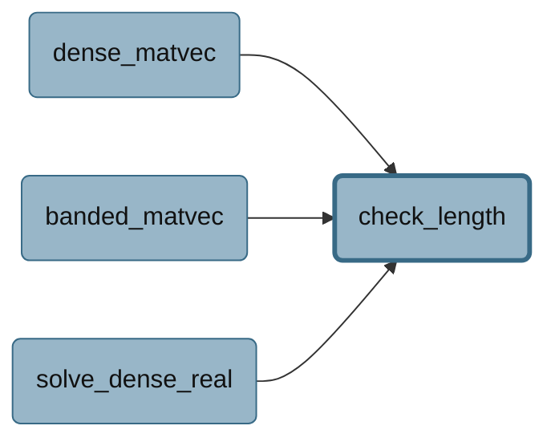
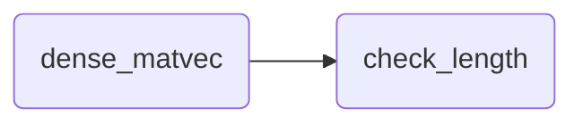

The generated pages use seven components from `fumadocs-fortran/react`, fumadocs' own `Callout` and `Cards`, and, for
the graphs, a `Mermaid` component that the site provides. The components are plain `createElement` code with no
state, effects or context and no `'use client'`, so the same set renders on the server and in client-side MDX;
`FortranRef` uses `useId`, which server components have too, to tie a hover card to its name. Rows that open, source
blocks, hover cards and the cards in which badges and pills say what they mean are HTML and CSS only. Every prop is a
string, a number or a boolean, except a row's `refs`.

## Set up

Register them with the site's MDX components:

```tsx title="components/mdx.tsx"
import defaultMdxComponents from 'fumadocs-ui/mdx';
import type { MDXComponents } from 'mdx/types';
import { fortranComponents } from 'fumadocs-fortran/react';

export function getMDXComponents(components?: MDXComponents) {
  return { ...defaultMdxComponents, ...fortranComponents, ...components };
}
```

and import the stylesheet once, in the root layout, before the site's own CSS, so that the site can change its
colours (see [Styling](#styling)):

```tsx title="app/layout.tsx"
import 'fumadocs-fortran/style.css';
import './global.css';
```

The pages also hold `$…$` and `$$…$$` maths, which need remark-math, rehype-katex and KaTeX's stylesheet. This
site adds them in [`lib/source.ts`](https://github.com/Nevensky/fumadocs-fortran/blob/main/docs/lib/source.ts) and
[`app/layout.tsx`](https://github.com/Nevensky/fumadocs-fortran/blob/main/docs/app/layout.tsx).

### Graphs

The dependency, inheritance and call graphs are ` ```mermaid ` blocks. fumadocs' `remarkMdxMermaid` turns each into
`<Mermaid chart="…" />`, and the site draws it. This site draws them as SVG at build time with
[Pele](https://github.com/obsidianmd/pele), so no script reaches the browser; see
[`components/mdx/mermaid.tsx`](https://github.com/Nevensky/fumadocs-fortran/blob/main/docs/components/mdx/mermaid.tsx).
The client-side Mermaid component of fumadocs' own docs works as well. A site that draws no graphs generates without
them: `graphs: false`, or `--graphs none`.

```ts title="lib/source.ts"
import { remarkMdxMermaid } from 'fumadocs-core/mdx-plugins';

// in defineDocs({ docs: { mdxOptions: applyMdxPreset({ … }) } })
remarkPlugins: [remarkMdxMermaid],
```

Pele throws on a diagram it cannot parse, and a ` ```mermaid ` block in a doc comment reaches the pages as it was
written, so the component shows such a diagram as its code rather than failing the page's build:

```tsx title="components/mdx/mermaid.tsx"
import { CodeBlock, Pre } from 'fumadocs-ui/components/codeblock';
import { render } from 'pele';

export function Mermaid({ chart }: { chart: string }) {
  let svg: string;
  try {
    svg = render(chart).svg;
  } catch {
    return (
      <CodeBlock title="Mermaid">
        <Pre>{chart}</Pre>
      </CodeBlock>
    );
  }
  return <div className="not-prose" dangerouslySetInnerHTML={{ __html: svg }} />;
}
```

Register `Mermaid` with the other components. Pele draws with CSS variables (`--pele-fg`, `--pele-line`, `--pele-bg`
and others), and without them for a light page: near-black arrows, which a dark theme hides, and labels in white
boxes. `fumadocs-fortran/style.css` maps them to fumadocs' colours for the graphs in a `FortranGraph`, so that their
lines, arrows and labels follow the light and dark themes, and colours their nodes by kind (see
[What the graphs show](#what-the-graphs-show)). A diagram that a site writes in a page itself, a ` ```mermaid ` block
outside a `FortranGraph`, needs the same mapping in the site's CSS. This site's:

```css title="app/global.css"
.pele:not(.fdf-graph .pele) {
  --pele-font: var(--font-sans);
  --pele-font-mono: var(--font-mono);
  --pele-bg: var(--color-fd-background);
  --pele-fg: var(--color-fd-foreground);
  --pele-muted: var(--color-fd-muted-foreground);
  --pele-line: var(--color-fd-muted-foreground);
  --pele-surface: var(--color-fd-card);
  --pele-surface-alt: var(--color-fd-secondary);
  --pele-border: var(--color-fd-border);
  --pele-accent: var(--color-fd-primary);
}
```

A plain `.pele` rule outside any `@layer` would apply to the generated graphs as well, as the stylesheet's mapping has
no specificity and is in no cascade layer: it is how a site changes their lines and labels.

### Letters in the table of contents

A generated page says what each heading is, in its front matter, and `fortranToc()` puts a letter for it in the
table of contents: `t` for a type, `s` a subroutine, `f` a function and so on. The page schema has to keep the
`fortran` field, which fumadocs' default schema drops. The schema is written with zod 4, which fumadocs-core lists
only as an optional peer dependency, so a site without it installs it (`npm install zod@4`):

```ts title="lib/source.ts"
import { pageSchema } from 'fumadocs-core/source/schema';
import { z } from 'zod';

// in defineDocs({ docs: { … } })
schema: pageSchema.extend({
  fortran: z.object({ kind: z.string().optional(), toc: z.record(z.string(), z.string()).optional() }).optional(),
}),
```

```tsx title="app/docs/[[...slug]]/page.tsx"
import { fortranToc } from 'fumadocs-fortran/react';

<DocsPage toc={fortranToc(page.data.toc, page.data.fortran?.toc)} full={page.data.full}>
```

### A site served under a base path

Markdown links go through the site's link component, which writes them as Next.js writes its own: with the
`basePath`, and, in a static export with `trailingSlash`, with the slash a page's address ends in
(`…/solver_kernels/#dense_matrix`). A hover card's link, a source header's and a graph node's are plain links that it
never sees. On a site served from a sub-path, such as a GitHub Pages project site, or exported with `trailingSlash`,
give the links among them that start with `/` the same: without the base path they lead off the site, and without
the slash a link to an anchor of the page being read loads the page again, through a redirect, instead of scrolling
to it. This site does it with `siteHref` in
[`lib/shared.ts`](https://github.com/Nevensky/fumadocs-fortran/blob/main/docs/lib/shared.ts): for the components in
[`components/mdx/fortran.tsx`](https://github.com/Nevensky/fumadocs-fortran/blob/main/docs/components/mdx/fortran.tsx),
which the site registers in their place, for the graphs in its `Mermaid`, and for the llms files and the pages'
Markdown copies in `lib/source.ts`.

## FortranBadges and FortranBadge

`FortranBadges` lays out a wrapping row of `FortranBadge` pills. The `kind` picks the colour and the default label,
and each badge says what it means in a card while the pointer is on it (see [Meanings](#meanings)). Hover over these:

<Tabs items={['Preview', 'MDX']}>
<Tab value="Preview">

Entities

<FortranBadges>
<FortranBadge kind="module" />
<FortranBadge kind="submodule" />
<FortranBadge kind="program" />
<FortranBadge kind="subroutine" />
<FortranBadge kind="function" />
<FortranBadge kind="type" />
<FortranBadge kind="interface" />
</FortranBadges>

Parallelism and offload

<FortranBadges>
<FortranBadge kind="omp" />
<FortranBadge kind="acc" />
<FortranBadge kind="offload" />
<FortranBadge kind="mpi" />
<FortranBadge kind="coarray" />
<FortranBadge kind="cuda" />
</FortranBadges>

Libraries, the preprocessor and C

<FortranBadges>
<FortranBadge kind="blas" />
<FortranBadge kind="lapack" />
<FortranBadge kind="scalapack" />
<FortranBadge kind="cpp" />
<FortranBadge kind="bindc" />
</FortranBadges>

Attributes

<FortranBadges>
<FortranBadge kind="pure" />
<FortranBadge kind="elemental" />
<FortranBadge kind="recursive" />
<FortranBadge kind="abstract" />
<FortranBadge kind="deferred" />
<FortranBadge kind="private" />
<FortranBadge kind="public" />
<FortranBadge kind="deprecated" />
</FortranBadges>

A label of its own, a condition, a note, and a kind the package does not know, which this site gives a meaning

<FortranBadges>
<FortranBadge kind="omp" label="OpenMP parallel region" />
<FortranBadge kind="mpi" conditional="USE_MPI" />
<FortranBadge kind="acc" conditional="_OPENACC" />
<FortranBadge kind="lapack" title="Calls DGETRF and DGETRS" />
<FortranBadge kind="hdf5" label="HDF5" />
</FortranBadges>

</Tab>
<Tab value="MDX">

```mdx
<FortranBadges>
<FortranBadge kind="module" />
<FortranBadge kind="omp" label="OpenMP parallel region" />
<FortranBadge kind="mpi" conditional="USE_MPI" />
<FortranBadge kind="lapack" title="Calls DGETRF and DGETRS" />
<FortranBadge kind="hdf5" label="HDF5" />
</FortranBadges>
```

</Tab>
</Tabs>

### Props of FortranBadge

<TypeTable
  type={{
    kind: {
      type: 'string',
      required: true,
      description:
        'Picks the colour, the default label and what the card says: module, submodule, program, subroutine, function, type, interface, omp, acc, offload, mpi, coarray, cuda, blas, lapack, scalapack, cpp, bindc, pure, elemental, recursive, abstract, deferred, private, public or deprecated, and impure, non-recursive, simple, parameter and blockdata for the card alone. Any other string gives a neutral badge, whose card says what it means when the site gives the kind a meaning.',
    },
    label: {
      type: 'string',
      default: "the kind's own, such as OpenMP for omp",
      description:
        'The text of the badge. Some labels say more than their kind, and so does the card: generic interface, operator, assignment, defined I/O, abstract interface and module interface for interface, separate module procedure for submodule, OpenMP parallel region for omp, OpenACC routine for acc, and conditional for cpp.',
    },
    conditional: {
      type: 'string',
      description:
        'A cpp condition, such as USE_MPI. The badge is dashed and ends in "when USE_MPI", because the feature exists only in builds where the condition holds, and its card says so under the meaning.',
    },
    title: {
      type: 'string',
      description:
        'More about the badge, such as the routines or the constructs it stands for: a line of its card, under the meaning, which screen readers read with the badge. It is no native tooltip. The generator leaves out a title that would only repeat the label, such as parallel under OpenMP parallel region.',
    },
  }}
/>

`FortranBadges` takes only `children`: the badges.

## FortranArgs and FortranArg

`FortranArgs` is a table in the manner of fumadocs' `TypeTable`: a title, a header row, and a `FortranArg` row for
each argument, result, component, type parameter, type-bound procedure or enumerator. A row shows the name, the type,
the shape (dimensions and codimensions), the intent and the attributes, and opens to its documentation, as full
Markdown, with the whole declaration, the intent, a type parameter's `kind` or `len` and each attribute beside its
meaning, the shape in words, a character type's length and the cpp condition it exists under. A name in the type
that `refs` lists links to its definition and shows a card on hover or keyboard focus; the intent, each attribute,
the shape, the `*` or `:` of `character(*)` and `character(:)` and the `kind` or `len` of a type parameter's type say
what they mean in a card on hover (see [Meanings](#meanings)). A type parameter's row reads as its declaration does:
the type `integer, kind` and one attribute, `default dp`, for `integer, kind :: k = dp`. In a column narrower than
34rem, a row keeps its name and intent, and the rest moves into what it opens to.

<Tabs items={['Preview', 'MDX']}>
<Tab value="Preview">

<FortranArgs>
<FortranArg name="n" type="integer" intent="in" decl="integer, intent(in) :: n">

The order of the matrix $A$, $n \ge 0$.

</FortranArg>
<FortranArg name="a" type="real(dp)" dims="(lda,*)" intent="inout" decl="real(dp), intent(inout) :: a(lda,*)" refs={{ dp: { href: 'https://gcc.gnu.org/onlinedocs/gfortran/ISO_005fFORTRAN_005fENV.html', title: 'dp ⇒ real64', detail: 'Real kind with a storage size of 64 bits: double precision', note: 'Renamed in the use statement at src/kinds.f90:3' } }}>

On entry, the $n \times n$ matrix $A$. On exit, the factors $L$ and $U$ of the factorisation

$$
A = P L U,
$$

where the unit diagonal of $L$ is not stored.

</FortranArg>
<FortranArg name="ipiv" type="integer" dims="(n)" intent="out" decl="integer, intent(out) :: ipiv(n)">

The pivot indices: row $i$ was interchanged with row `ipiv(i)`.

</FortranArg>
<FortranArg name="m" type="class(dense_matrix)" intent="in" decl="class(dense_matrix), intent(in) :: m" refs={{ dense_matrix: { href: '/docs/showcase/modern/solver_kernels#dense_matrix', title: 'type, extends(abstract_matrix) :: dense_matrix', detail: 'Dense, column-major matrix.' } }}>

A matrix of the [Showcase](/docs/showcase/modern/solver_kernels#dense_matrix): its name links to its type.

</FortranArg>
<FortranArg name="tol" type="real(dp)" intent="in" optional decl="real(dp), intent(in), optional :: tol">

The tolerance. Without it, `epsilon(1.0_dp)`.

</FortranArg>
<FortranArg name="alpha" type="real(c_double)" value decl="real(c_double), value :: alpha" refs={{ c_double: { href: 'https://gcc.gnu.org/onlinedocs/gfortran/ISO_005fC_005fBINDING.html', title: 'c_double', detail: 'Real kind interoperable with C double', note: 'From the use statement at src/kinds.f90:4' } }}>

Passed by value, as C passes it.

</FortranArg>
<FortranArg name="what" type="character(*)" intent="in" decl="character(*), intent(in) :: what">

The name of the vector, for the message. Its length is the actual argument's.

</FortranArg>
<FortranArg name="work" type="real(dp)" dims="(:)" attrs="allocatable, target" intent="inout" decl="real(dp), intent(inout), allocatable, target :: work(:)">

Workspace, grown when needed:

- at least $3n$ entries;
- kept between calls.

</FortranArg>
<FortranArg name="halo" type="real(dp)" dims="(:,:)" codims="[*]" decl="real(dp) :: halo(:,:)[*]">

A coarray: one block on every image.

</FortranArg>
<FortranArg name="comm" type="type(MPI_Comm)" intent="in" cond="USE_MPI" decl="type(MPI_Comm), intent(in) :: comm" refs={{ MPI_Comm: { href: 'https://www.mpi-forum.org/docs/mpi-5.0/mpi50-report/node35.htm', title: 'MPI_Comm', detail: 'Handle of a communicator: a group of processes and the context their messages are sent in.', note: 'From the use of mpi_f08 at src/solver.F90:5' } }}>

The communicator. The argument exists only when the code is built with `-DUSE_MPI`.

</FortranArg>
<FortranArg name="info" type="integer" intent="out" />
</FortranArgs>

<FortranArgs title="Result" columns="type intent">
<FortranArg name="nrm" type="real(dp)" result decl="real(dp) :: nrm">

The global 2-norm, $\|x\|_2$.

</FortranArg>
</FortranArgs>

<FortranArgs title="Type parameters" columns="type attrs">
<FortranArg name="k" type="integer, kind" attrs="default dp" decl="integer, kind :: k = dp">

The kind of the entries.

</FortranArg>
<FortranArg name="n" type="integer, len" decl="integer, len :: n">

The order of the matrix, which each object gives: `type(matrix(n=3)) :: a`.

</FortranArg>
</FortranArgs>

</Tab>
<Tab value="MDX">

```mdx
<FortranArgs>
<FortranArg name="a" type="real(dp)" dims="(lda,*)" intent="inout"
  decl="real(dp), intent(inout) :: a(lda,*)"
  refs={{ dp: { href: 'https://gcc.gnu.org/onlinedocs/gfortran/ISO_005fFORTRAN_005fENV.html',
    title: 'dp ⇒ real64', detail: 'Real kind with a storage size of 64 bits: double precision' } }}>

On entry, the $n \times n$ matrix $A$. On exit, the factors $L$ and $U$.

</FortranArg>
<FortranArg name="tol" type="real(dp)" intent="in" optional>

The tolerance. Without it, `epsilon(1.0_dp)`.

</FortranArg>
<FortranArg name="what" type="character(*)" intent="in">

The name of the vector, for the message.

</FortranArg>
<FortranArg name="halo" type="real(dp)" dims="(:,:)" codims="[*]">

A coarray: one block on every image.

</FortranArg>
<FortranArg name="comm" type="type(MPI_Comm)" intent="in" cond="USE_MPI">

The communicator.

</FortranArg>
<FortranArg name="info" type="integer" intent="out" />
</FortranArgs>

<FortranArgs title="Result" columns="type intent">
<FortranArg name="nrm" type="real(dp)" result>

The global 2-norm, $\|x\|_2$.

</FortranArg>
</FortranArgs>

<FortranArgs title="Type parameters" columns="type attrs">
<FortranArg name="k" type="integer, kind" attrs="default dp" decl="integer, kind :: k = dp">

The kind of the entries.

</FortranArg>
</FortranArgs>
```

Leave a blank line after an opening `<FortranArg>` and before its closing tag, so that what is between them is read
as Markdown. A row opens when it has more to say than its cells: a doc, a declaration, a shape, a condition, a `*` or
`:` length, or an intent (`in`, `out` or `inout`), an attribute or a type parameter's `kind` or `len`, whose meanings
it says in words for the keyboard and screen readers, as `info` does. A row with none of these, such as a result's
with only its type, does not open, and its `result` pill says what it means on hover alone.

</Tab>
</Tabs>

### Props of FortranArgs

<TypeTable
  type={{
    title: {
      type: 'string',
      default: 'Arguments',
      description: 'The title of the table, such as Result or Components. An empty string leaves it out.',
    },
    columns: {
      type: 'string',
      default: 'type shape intent attrs',
      description:
        'The columns to show besides the name, space-separated, drawn in that order. The generator lists only those some row fills, and an empty string shows the names alone.',
    },
    children: {
      type: 'ReactNode',
      description: 'The FortranArg rows.',
    },
  }}
/>

### Props of FortranArg

<TypeTable
  type={{
    name: {
      type: 'string',
      required: true,
      description: 'The name of the argument, result, component, binding or enumerator.',
    },
    type: {
      type: 'string',
      description:
        "The type, as declared: integer, real(dp), type(MPI_Comm), class(*) and so on, or a type parameter's, such as integer, kind, whose kind or len says what it means on hover and in the opened row. The * or : of character(*) and character(:) says what it means on hover, and an opened row gives the length of any character type: assumed, deferred, as written, or 1, the default. The * of a result's character(*), an obsolescent form, says that it takes the length the caller declares for the function.",
    },
    dims: {
      type: 'string',
      description:
        'The dimensions, in the shape column, such as (:,:) or (lda,*). Parentheses are added when missing. The card and the opened row say the shape in words: rank 2, assumed shape.',
    },
    codims: {
      type: 'string',
      description: 'The codimensions of a coarray, such as [*]. Brackets are added when missing.',
    },
    intent: {
      type: "'in' | 'out' | 'inout'",
      description:
        'The intent: → in, ← out and ↔ inout, each in a colour of its own and with a card that says what it means, as the opened row does; in out reads as inout, and any other value is shown as written, with no card.',
    },
    result: {
      type: 'boolean',
      default: 'false',
      description: "A function's result: the intent column says result.",
    },
    optional: {
      type: 'boolean',
      default: 'false',
      description: 'The optional attribute.',
    },
    value: {
      type: 'boolean',
      default: 'false',
      description: 'The value attribute.',
    },
    attrs: {
      type: 'string',
      description:
        "Other attributes, as comma-separated text, such as allocatable, target or pass(self), or a type parameter's default, as default dp. Each is a pill with a card that says what it means, as the opened row does beside it.",
    },
    cond: {
      type: 'string',
      description:
        'A cpp condition, such as USE_MPI: the row exists only in builds where it holds, and says so ("when USE_MPI"), dashed and with a card.',
    },
    decl: {
      type: 'string',
      description: 'The whole declaration as Fortran, shown when the row opens: real(dp), intent(in), optional :: x(:).',
    },
    refs: {
      type: 'Record<string, { href?: string; title: string; detail?: string; note?: string }>',
      description:
        "Names in the type that link and have a hover card, by name: each whole-word occurrence, in any case, becomes a FortranRef. An object, or the same as JSON text. The generator gives one for each kind name and derived type it can place, mpi_f08's types and omp_lib's kinds included.",
    },
    children: {
      type: 'ReactNode',
      description: 'The documentation, as Markdown: paragraphs, lists, code, tables and maths. It may be absent.',
    },
  }}
/>

## Meanings

A badge, an intent, an attribute, a condition, a shape, the `*` or `:` of `character(*)` and `character(:)` and the
`kind` or `len` of a type parameter's `integer, kind` say what they mean in a card while the pointer is on them, in
the look of the hover cards. In the Arguments table of [FortranArgs and FortranArg](#fortranargs-and-fortranarg),
`allocatable` says "Allocated at run time, by allocate or on assignment, and freed by deallocate (a local one also on
return)", `(lda,*)` "rank 2, assumed size", and the `*` of `character(*)` "Assumed length (len=\*): taken from the
actual argument".

The meanings are written once, in `fumadocs-fortran/style.css`. The components name each one's term in a `data-term`
attribute, and what goes with it in `data-arg` (`self` in `pass(self)`, `dp` in `default dp`, `USE_MPI` in
`when USE_MPI`), and the stylesheet draws the card for the term, so that a page of thousands of pills holds no meaning
twice. A shape is the exception: its words are the components' own, in English, made from the dimensions and written
in `data-arg`. A term the stylesheet has no meaning for, such as a site's own badge kind, shows no card, but for a
badge with a `title`, whose card holds the title alone.

The cards are for the pointer: Tab does not stop at a pill, which has no native tooltip either, and in current
browsers screen readers do not read a card with its row. So a row with an intent, an attribute or a type parameter's
`kind` or `len` opens, if only to say the same for the keyboard and screen readers: its intent and its type
parameter's `kind` or `len` in words, each attribute beside its meaning, and its shape, length and condition. A
badge's meaning is for the pointer alone; its `title` is text in the badge, which
screen readers read with it. On a touch screen, a tap on a pill in a row opens the row, which says what the pill
means, so the pill shows no card there. Where the browser has CSS anchor positioning, a card is placed against what
it explains and the screen, as a hover card is; elsewhere the card of a pill in the table's last columns opens
towards the table, and a badge's below its row of badges, from the row's start, so that it stays on a phone's
screen. Cards are not printed, and an opened row prints its meanings.

A site gives a term a meaning, or one in its own words or language, with a rule in its own CSS. The stylesheet's
meanings are in `:where()`, which has no specificity, and in no cascade layer, so a rule on `[data-term='…']` outside
any `@layer` wins wherever the site's CSS comes; inside one, such as Tailwind's `@layer base` or `@layer components`,
it loses to the stylesheet's meaning, whatever its specificity. `attr(data-arg)` puts in what goes with the term.
This site gives the HDF5 badge above its meaning:

```css title="app/global.css"
[data-term='hdf5'] {
  --fdf-mean: "HDF5: a library and file format for large scientific data";
}
```

and `[data-term='default'][data-arg] { --fdf-mean: "Defaults to " attr(data-arg); }` would reword the card of
`default dp`. A rule for a term rewords what an opened row says of it as well, as its Intent, Type parameter and
Length lines and its list of attributes show the same meanings. A shape's card is reworded one shape at a time, as with
`[data-term='shape'][data-arg='rank 2, assumed size']`, and its Shape line not at all. A badge with a condition says
so on a line under its meaning, "Only when the preprocessor condition USE_MPI holds": that line is `--fdf-also`,
which `[data-term='mpi'][data-arg] { --fdf-also: "\A Only in builds with " attr(data-arg); }` would reword for the
MPI badge. The terms the stylesheet has meanings for are:

- for a badge, its kind: `module`, `submodule`, `program`, `blockdata`, `subroutine`, `function`, `type`,
  `interface`, `omp`, `acc`, `offload`, `mpi`, `coarray`, `cuda`, `blas`, `lapack`, `scalapack`, `cpp`, `bindc`,
  `pure`, `impure`, `elemental`, `recursive`, `non-recursive`, `simple`, `abstract`, `deferred`, `private`,
  `public`, `deprecated` and `parameter`; or that of a label of its own: `generic-interface`, `operator-interface`,
  `assignment-interface`, `dtio-interface`, `abstract-interface`, `module-interface`, `separate-procedure`,
  `omp-parallel`, `acc-routine` and `conditional` (with its condition in `data-arg` or without one); and `when` for a
  badge with only a condition;
- for an intent, `intent-in`, `intent-out` and `intent-inout`, and `result` for a function's result;
- for an attribute, its keyword in lower case: `allocatable`, `pointer`, `target`, `contiguous`, `optional`,
  `value`, `save`, `volatile`, `asynchronous`, `protected`, `external`, `intrinsic`, `parameter`, `private`,
  `public`, `bind` (for `bind(c)`), `rank` (for `rank(2)`), `kind` and `len`, the bindings' `deferred`, `nopass`,
  `pass` (for `pass(self)`) and `non_overridable`, and CUDA Fortran's `device`, `managed` and `pinned`; `default` for
  `default dp`, `init` for `= 0` and `pointer-init` for `=> null()`;
- `when` for a condition, `shape` for a shape, with its words in `data-arg`, `assumed-length` and `deferred-length`
  for the `*` and `:` of a character length, `assumed-length-result` for the `*` of a function's result, and `kind`
  and `len`, as for an attribute, for the word of a type parameter's type, as in `integer, kind`.

## FortranRef

A name that links to its definition and shows a card while it is hovered or has the keyboard's focus: a first line
in code, a line of text, and a muted note. The rows use it for kind names and derived types, and a "Calls:" line for
the library routines it names (see [Library names](#library-names)); in text it stands on its own. Hover over these
names, or reach them with Tab:

{/* the examples are expressions, which search leaves out */}
<p>
  {<><FortranRef href="/docs/showcase/modern/solver_kernels#abstract_matrix" title="type, abstract :: abstract_matrix" detail="An abstract matrix type.">abstract_matrix</FortranRef> is the type the matrices of the Showcase extend.</>}
</p>

<p>
  {<><FortranRef href="https://gcc.gnu.org/onlinedocs/gfortran/ISO_005fFORTRAN_005fENV.html" title="dp ⇒ real64" detail="Real kind with a storage size of 64 bits: double precision" note="Renamed in the use statement at examples/modern/src/modern_ford.F90:21">dp</FortranRef> is their kind.</>}
</p>

<p>
  {<>The Showcase's <code>solve_dense_real</code> calls <FortranRef href="https://netlib.org/lapack/explore-html/d8/da6/group__gesv_ga831ce6a40e7fd16295752d18aed2d541.html#ga831ce6a40e7fd16295752d18aed2d541" title="subroutine dgesv (LAPACK)" detail="Computes the solution to system of linear equations A * X = B for GE matrices"><code>dgesv</code></FortranRef>, as its "Calls:" line shows.</>}
</p>

```mdx
<FortranRef href="/docs/showcase/modern/solver_kernels#abstract_matrix" title="type, abstract :: abstract_matrix"
  detail="An abstract matrix type.">abstract_matrix</FortranRef> is the type the matrices of the Showcase extend.

**Calls:** <FortranRef
  href="https://netlib.org/lapack/explore-html/d8/da6/group__gesv_ga831ce6a40e7fd16295752d18aed2d541.html#ga831ce6a40e7fd16295752d18aed2d541"
  title="subroutine dgesv (LAPACK)"
  detail="Computes the solution to system of linear equations A * X = B for GE matrices">`dgesv`</FortranRef>
```

The card sits inside the name, so that a click on it follows the link and, in a row, does not open or close the row.
Without `href` the name is a button that does nothing, which the keyboard reaches and which shows the card while it
has the focus. For screen readers the card describes its name (`aria-describedby`) and has no text of its own
(`aria-hidden`), so that a row is read without it. The card is CSS only: it hides when the pointer or the focus
leaves the name, and Escape cannot dismiss it. Where the browser has CSS anchor positioning, the card is placed
against its name and the screen, on the side where it fits. Elsewhere it opens below the name, or, so that it stays
on a phone's screen, below the field of an opened row or the paragraph of running text it is in, such as a "Calls:"
line, from the start of either. Cards are not printed.

### Library names

The package ships a registry of the names of HPC libraries (`registry/`): BLAS and LAPACK, ScaLAPACK with PBLAS,
BLACS, its tools and REDIST, and the routines it writes in C for Fortran to call (`?lamov`, `pcrot`, `pzrot`, the
`p?laiect`, `p?lasnbt` and `p?lachkieee` routines, `reshape`, `sl_gridreshape`, `PB_topget`, `PB_topset` and
`PB_freebuf`), MPI, OpenMP, OpenACC and the Fortran intrinsics. The generator gives their names cards from it:

- **Calls.** In the "Calls:" line of a procedure or a program, a library subroutine is a `FortranRef`, as `dgesv`
  above: its kind, name and library, the registry's summary and a link to its documentation, each where there is
  one. The registry has a summary for every subroutine of BLAS, LAPACK, MPI and the intrinsics, for all of
  ScaLAPACK's but two, and for the most used of OpenMP and OpenACC. BLAS, LAPACK and ScaLAPACK routines link to
  Netlib or, when the code uses one of MKL's modules (`lapack95`, `blas95`, `f95_precision`, `mkl_*`), to Intel
  oneMKL's page for the routine (BLACS, the tools and REDIST stay on Netlib; the address is made from the routine's
  name and not checked, as intel.com refuses scripts); MPI's to Open MPI 5.0's manual, or to Open MPI's development
  manual for a newer one that 5.0 lacks; OpenMP's to the 5.2 specification (a later one for a routine 5.2 lacks);
  OpenACC's to the 3.4 specification; and an intrinsic subroutine, such as `co_sum`, to fortran-lang.org, or to
  gfortran's manual for one that fortran-lang.org lacks (`random_init`, `split`). A routine with no page to link to,
  such as the intrinsic `tokenize` or MPI's predefined callbacks, has a card without a link, a button. A routine that
  a use statement renames is looked up by its own name. The line lists `CALL` statements, so a function such as
  `dnrm2` has no card, though the call graphs draw it. A site chooses other pages with `hpc.links`, or `--links`, by
  library: `lapack` and `scalapack` take `netlib` or `mkl`, `mpi` `openmpi`, `mpich` or `standard`, `openmp` `5.2`,
  `6.0`, `6.1` or `libgomp`, `openacc` `spec` or `libgomp`, and `intrinsics` `fortran-lang` or `gfortran`
  (`--links lapack=mkl,mpi=mpich`); a name its provider has no page for links as by default.
- **Types and kinds.** In a row, the derived types of `mpi_f08` (`type(MPI_Comm)`, `MPI_Datatype`, `MPI_Request`,
  `MPI_Status`, …) and the kinds of `omp_lib` or `omp_lib_kinds` (`integer(omp_lock_kind)`) have a card when the
  declaration's scope uses the module, by `use` (`use, intrinsic :: omp_lib` too), an `only` list or a rename,
  through its host or through a module of the project that passes the name on: the registry's line on the name, a
  link to the MPI 5.0 standard or the OpenMP specification, and the use statement it comes from. `use mpi`, whose
  handles are integers, gives none.
- **The project wins.** A procedure, generic interface or variable of the project, shown or not, a dummy argument in
  scope, or a procedure pointer the caller declares (in a `BLOCK`, in its specification part or in its host's) is
  never taken for a library's: the project's own `dgemm` keeps its link, or stays code when it has no heading, a
  call through such a pointer has no card, and a module of the project named `mpi_f08`, such as a serial stub, gives
  its own types. An interface body that only describes a library routine, as code writes one for `dgesv`, does not
  count: a call links to it when it has a heading, and has the library's card when it has none. A `pointer`
  statement on its name makes it a procedure pointer, which does. A `CALL` of a name the registry has as a function,
  or of an intrinsic's name that another module's use statement gives, names some other subroutine and has no card,
  unless the registry has a subroutine of the name: `call reshape` is ScaLAPACK's `reshape`, of its tools, not the
  intrinsic function.

The registry is read when the pages are generated, the first time a page needs it. Without it, the names are shown
as code, with no card, and the graphs leave LAPACK and ScaLAPACK grey. `hpc.cards: false`, or
`--library-cards none`, leaves the names as code, with no card, and keeps the graphs' colours.

### Props of FortranRef

<TypeTable
  type={{
    href: {
      type: 'string',
      description:
        'Where the name links: a heading of the reference, or a page about the name. Without it the name is a button that only shows the card.',
    },
    title: {
      type: 'string',
      required: true,
      description: "The card's first line, in code, such as the name's declaration.",
    },
    detail: {
      type: 'string',
      description: 'A line of text under it, such as the summary of its doc.',
    },
    note: {
      type: 'string',
      description: 'A muted line last, such as where the name was renamed.',
    },
    children: {
      type: 'ReactNode',
      description: 'The name.',
    },
  }}
/>

## FortranSource

An entity's source: "Source code in" its file, its lines and a link to them. With a code block inside, it is a block
that opens to the code, numbered from the entity's first line; without one, the line alone, which links when `href`
is given. The generator puts in the code of each procedure, type, interface, variable and enum of up to 400 lines,
and links modules, submodules and programs; `source: 'link'`, or `--source link`, only links. It reads the code from
the files it parsed, those it was given and the files they include, wherever they lie, so that
`fumadocs-fortran generate ../src` run in a site's folder embeds it too.

<Tabs items={['Preview', 'MDX']}>
<Tab value="Preview">

<FortranSource file="examples/modern/src/modern_ford.F90" line={166} lineEnd={171} href="https://github.com/Nevensky/fumadocs-fortran/blob/main/examples/modern/src/modern_ford.F90#L166-L171">

```f90 lineNumbers=166
  subroutine check_length(n, m, what)
    integer, intent(in) :: n !! the matrix's order
    integer, intent(in) :: m !! the vector's length
    character(*), intent(in) :: what !! the vector's name, for the message
    if (m /= n) error stop 'solver_kernels: ' // what // ' does not fit the matrix'
  end subroutine check_length
```

</FortranSource>

<FortranSource
  file="examples/modern/src/modern_ford.F90"
  line={3}
  lineEnd={256}
  href="https://github.com/Nevensky/fumadocs-fortran/blob/main/examples/modern/src/modern_ford.F90#L3-L256"
/>

<FortranSource file="examples/modern/src/modern_doxygen.f90" line={25} />

</Tab>
<Tab value="MDX">

````mdx
<FortranSource file="examples/modern/src/modern_ford.F90" line={166} lineEnd={171}
  href="https://github.com/Nevensky/fumadocs-fortran/blob/main/examples/modern/src/modern_ford.F90#L166-L171">

```f90 lineNumbers=166
  subroutine check_length(n, m, what)
  …
  end subroutine check_length
```

</FortranSource>

<FortranSource
  file="examples/modern/src/modern_ford.F90"
  line={3}
  lineEnd={256}
  href="https://github.com/Nevensky/fumadocs-fortran/blob/main/examples/modern/src/modern_ford.F90#L3-L256"
/>
````

</Tab>
</Tabs>

### Props of FortranSource

<TypeTable
  type={{
    file: {
      type: 'string',
      required: true,
      description: 'The source file, relative to the repository.',
    },
    line: {
      type: 'number',
      required: true,
      description: 'The first line of the entity.',
    },
    lineEnd: {
      type: 'number',
      description: 'The last line, when the entity spans more than one.',
    },
    href: {
      type: 'string',
      description: 'Where the lines can be read, such as the file on GitHub with #L166-L171. Its host names the link.',
    },
    children: {
      type: 'ReactNode',
      description: 'The code, as a code block. Without it, the line alone.',
    },
  }}
/>

## FortranGraph

A graph, with an optional title: an open card, or, with `collapsed`, a block that opens to it. The generator draws a
unit's dependencies and the overview's units open, the overview's with no title, under a heading of its own, and a
type's inheritance and the calls of a procedure, a program or a generic collapsed.

<Tabs items={['Preview', 'MDX']}>
<Tab value="Preview">

<FortranGraph title="Call graph">



</FortranGraph>

</Tab>
<Tab value="MDX">

````mdx
<FortranGraph title="Call graph" collapsed>



</FortranGraph>
````

</Tab>
</Tabs>

### What the graphs show

- **Graphs.** A unit's dependencies are the modules that it and everything in it use, followed two steps deep
  through the project's modules, then what uses it, and its submodules or, for a submodule, its parents. A type's
  inheritance is the types it extends, up to the root, and every type that extends it. A procedure's calls are what
  it calls, two steps deep through the project's procedures, and what calls it. The overview has every module,
  submodule and program, with one node for each HPC library they use. A graph draws at most 40 nodes, the last of
  them standing for the rest ("… 12 more"): the routines from outside the project go first, however many callers
  they have, the farthest first, then the farthest of the rest. A project of more than 80 units has no overview
  graph. From JavaScript, `graphs: { depth, maxNodes }` changes the two steps and the 40 nodes, and `maxNodes` the 80
  units as well.
- **Calls.** A call is a `CALL` statement or a function reference, resolved as Fortran resolves it: through `use`,
  renames, host association, generic interfaces and submodules. A type-bound one (`call m%solve(b)`,
  `n = m%order()`) is drawn when `m` is a dummy argument, a function result or a module variable, whose type the
  model knows, and not through a local variable, as the model keeps no local declarations. Intrinsic procedures are
  left out, and a function reference to a name the project does not declare is drawn only when the name is a known
  library's, such as LAPACK's `dlamch`, as it might as well be an array. A node bears the name as the source first
  writes it, so fixed-form code's `DLAMCH` stands beside its `DGEMM`. A `CALL` of a name that only an intrinsic
  function has names some other routine, drawn as one from outside the project; the registry knows ScaLAPACK's own
  `reshape`, which `call reshape` draws in ScaLAPACK's colour. A call through a procedure pointer the caller declares
  is not drawn.
- **Shapes.** A module and a type are boxes, a submodule a box with double sides, a program a stadium, a procedure a
  rounded box and a generic interface or binding a hexagon. A module or routine from outside the project is a rounded
  box. The graph's subject has a heavier border.
- **Colours.** Each kind of the project's entities has a colour: modules, submodules, programs, procedures (functions
  and subroutines alike), generics and types; an abstract type has a dashed border in the type's colour. A routine or
  module from outside the project takes its library's colour:
  - BLAS, LAPACK and ScaLAPACK: the routines the registry of library names knows (see
    [Library names](#library-names)), BLAS first, so that the BLAS routines Reference-LAPACK ships stay BLAS, and
    PBLAS, BLACS, ScaLAPACK's tools and REDIST with ScaLAPACK;
  - MPI: `mpi_*` routines, and the modules `mpi`, `mpi_f08` and `mpif`;
  - OpenMP: `omp_*`, `omp_lib` and `omp_lib_kinds`; OpenACC: `acc_*` and `openacc`;
  - CUDA: routines whose names start with `cuda`, `cublas`, `cufft`, `curand`, `cusparse` or `cusolver`, in any case,
    and the modules `cudafor`, `cublas`, `cufft`, `curand`, `cusparse` and `cusolverDn`;
  - the coarray collectives (`co_sum`, `co_min`, `co_max`, `co_reduce`, `co_broadcast`).

  `graphs.classify`, a JavaScript option of `generate()` and `buildPages()`, takes the registry's place: it names the
  library of a routine the project does not define from its lower-case name, such as
  `(name) => (MYLIB.has(name) ? 'lapack' : null)` with a set of names; the CLI has no such option. With it, or
  without the registry, the names alone still tell MPI, OpenMP, OpenACC, CUDA, the coarray collectives and BLAS. The
  other routines and modules from outside the project are grey and dashed, and the intrinsic modules
  (`iso_fortran_env`, `iso_c_binding`, the IEEE modules) grey.
- **Edges.** An arrow is a use, an extension (from a type to its parent) or a call. A label on it is the cpp condition
  it holds under, which a `use` statement or a `CALL` statement gives; a function reference is never labelled, as the
  parser keeps no condition for it. A dotted arrow goes from a generic to its specific procedures, and one labelled
  "submodule of" from a submodule to its parent.
- **Links.** A node links to the heading that documents it; a routine from outside the project links to the interface
  body that documents it, if there is one.

The Mermaid holds fixed mid tones for each kind of node, which read on light and dark backgrounds whatever draws them.
With Pele, `fumadocs-fortran/style.css` draws the nodes in the theme's colours instead, from the variables under
[Styling](#styling), and the lines, arrows and labels in fumadocs' (see [Graphs](#graphs)).

### Props of FortranGraph

<TypeTable
  type={{
    title: {
      type: 'string',
      description:
        "The card's caption, or what a collapsed block shows until it opens. Without it an open card has no caption, as the generated overview has none, and a collapsed block says Graph.",
    },
    collapsed: {
      type: 'boolean',
      default: 'false',
      description: 'A block that starts closed, rather than an open card.',
    },
    children: {
      type: 'ReactNode',
      description: 'The diagram: a ```mermaid block, which the site draws.',
    },
  }}
/>

## fortranToc

`fortranToc(toc, kinds)` returns fumadocs' table of contents with a letter before each entry whose anchor `kinds`
names: a generated page's front matter `fortran.toc`. Wire it in as in
[Letters in the table of contents](#letters-in-the-table-of-contents); entries it has no kind for stay as they are.

<div className="not-prose flex flex-wrap gap-x-5 gap-y-2 text-sm">
  <span className="fdf-toc"><span className="fdf-toc-kind fdf-toc-module">mod</span><span className="fdf-toc-name">module</span></span>
  <span className="fdf-toc"><span className="fdf-toc-kind fdf-toc-submodule">smod</span><span className="fdf-toc-name">submodule</span></span>
  <span className="fdf-toc"><span className="fdf-toc-kind fdf-toc-program">prog</span><span className="fdf-toc-name">program</span></span>
  <span className="fdf-toc"><span className="fdf-toc-kind fdf-toc-type">t</span><span className="fdf-toc-name">type</span></span>
  <span className="fdf-toc"><span className="fdf-toc-kind fdf-toc-interface">i</span><span className="fdf-toc-name">interface</span></span>
  <span className="fdf-toc"><span className="fdf-toc-kind fdf-toc-subroutine">s</span><span className="fdf-toc-name">subroutine</span></span>
  <span className="fdf-toc"><span className="fdf-toc-kind fdf-toc-function">f</span><span className="fdf-toc-name">function</span></span>
  <span className="fdf-toc"><span className="fdf-toc-kind fdf-toc-variable">v</span><span className="fdf-toc-name">variable</span></span>
  <span className="fdf-toc"><span className="fdf-toc-kind fdf-toc-parameter">p</span><span className="fdf-toc-name">parameter</span></span>
  <span className="fdf-toc"><span className="fdf-toc-kind fdf-toc-enum">e</span><span className="fdf-toc-name">enum</span></span>
</div>

## Notes and warnings

FORD's `@note`, `@warning`, `@bug` and `@todo`, and their Doxygen counterparts, become fumadocs' own `Callout`, which
every fumadocs site already registers:

<Callout type="info" title="Note">
  A FORD `@note` becomes a callout like this one.
</Callout>

<Callout type="warn" title="Warning">
  So does a `@warning`.
</Callout>

<Callout type="error" title="Bug">
  And a `@bug`.
</Callout>

## fortranComponents

`fortranComponents` holds all seven, `{ FortranBadges, FortranBadge, FortranArgs, FortranArg, FortranRef,
FortranSource, FortranGraph }`, to spread into `getMDXComponents()` as in [Set up](#set-up). Each is also a named
export, for use in TSX, with its props' types: this site's home page draws a procedure with them.

```tsx
import {
  FortranArg,
  FortranArgs,
  FortranBadge,
  FortranBadges,
  FortranGraph,
  FortranSource,
  type FortranRefTarget,
} from 'fumadocs-fortran/react';
```

## Styling

`fumadocs-fortran/style.css` is plain CSS on `.fdf-*` classes, built on fumadocs' colour variables, so it follows
the site's theme in light and dark mode. It needs no Tailwind `@source` line. Sites can change these colours:

| Variable | Colours |
| --- | --- |
| `--fdf-omp`, `--fdf-acc`, `--fdf-offload` | OpenMP, OpenACC and offload badges, and the OpenMP and OpenACC nodes of the graphs |
| `--fdf-mpi`, `--fdf-coarray` | MPI and coarray badges, and their graph nodes |
| `--fdf-cuda` | CUDA Fortran badges, and the CUDA nodes of the graphs |
| `--fdf-blas`, `--fdf-lapack`, `--fdf-scalapack` | the libraries' badges, and the graph nodes of their routines |
| `--fdf-cpp` | cpp badges |
| `--fdf-in`, `--fdf-out`, `--fdf-inout` | the intent markers of arguments |
| `--fdf-k-module`, `--fdf-k-submodule`, `--fdf-k-program`, `--fdf-k-type` | the letters in the table of contents, and the graph nodes of each kind (block data with the programs) |
| `--fdf-k-interface` | the letter `i`, and the generics of the graphs |
| `--fdf-k-subroutine` | the letter `s`, and every procedure of the graphs, functions included |
| `--fdf-k-function`, `--fdf-k-variable`, `--fdf-k-parameter`, `--fdf-k-enum` | the letters `f`, `v`, `p` and `e` in the table of contents |

Each is one mid tone for both themes: the text mixes it with black in light mode and with white in dark mode, and
the tint and the border are made from it. The grey of what lies outside the project is fumadocs' muted foreground.
Set them on `:root`, outside any `@layer`, in CSS that comes after the stylesheet, such as the site's own
`app/global.css` imported after it, as in [Set up](#set-up) (the stylesheet is in no cascade layer, and its values
beat a layered rule's):

```css title="app/global.css"
:root {
  --fdf-mpi: oklch(0.6 0.12 190);
}
```

The meanings of badges and pills are custom properties too, one per term: [Meanings](#meanings) says how to add or
reword one.

On paper, every row is printed open, with its documentation, its declaration and the meanings of its pills; source
blocks and graphs are printed as they are on the screen, open or closed, and cards not at all. On a right-to-left
page, the Fortran in the tables and cards (names, types, shapes, declarations and conditions) still reads left to
right.
