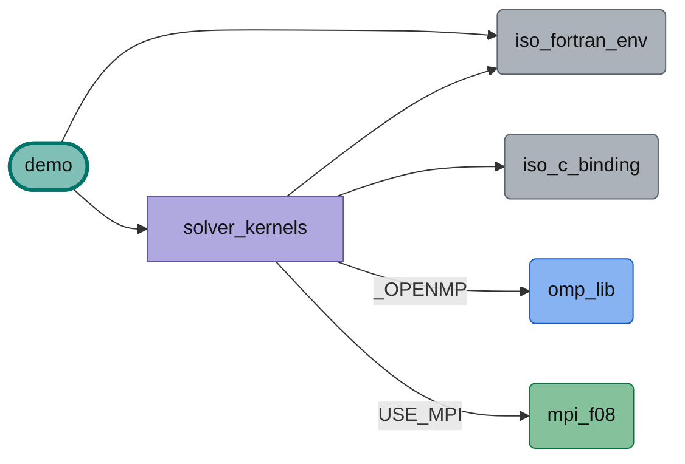
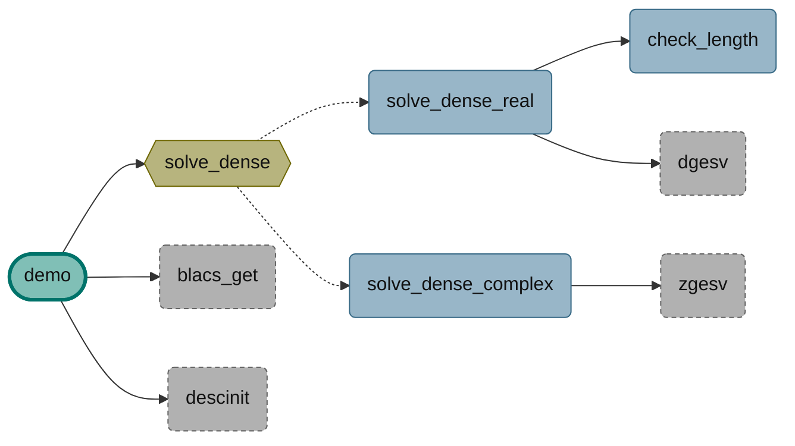

{/* Generated by fumadocs-fortran from examples/modern/src/modern_ford.F90. Do not edit. */}

<FortranBadges>
<FortranBadge kind="program" />
</FortranBadges>

Runs the kernels; distributed with ScaLAPACK `pdgesv` when built with MPI.

**Uses:** `iso_fortran_env` (`dp => real64`); [`solver_kernels`](/docs/showcase/modern/solver_kernels)

**Calls:** [`solve_dense`](/docs/showcase/modern/solver_kernels#solve_dense), `blacs_get`, `descinit`

<FortranSource file="examples/modern/src/modern_ford.F90" line={280} lineEnd={295} href="https://github.com/Nevensky/fumadocs-fortran/blob/main/examples/modern/src/modern_ford.F90#L280-L295" />

<FortranGraph title="Dependencies">

</FortranGraph>

<FortranGraph title="Call graph" collapsed>

</FortranGraph>
