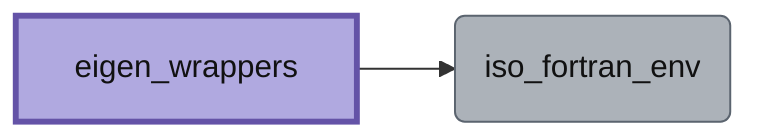
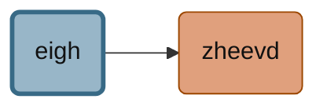
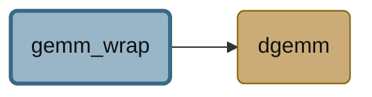

{/* Generated by fumadocs-fortran from examples/modern/src/modern_doxygen.f90. Do not edit. */}

<FortranBadges>
<FortranBadge kind="module" />
</FortranBadges>

<small>Author: A. Person</small>

**Uses:** `iso_fortran_env` (`wp => real64`)

<FortranSource file="examples/modern/src/modern_doxygen.f90" line={8} lineEnd={61} href="https://github.com/Nevensky/fumadocs-fortran/blob/main/examples/modern/src/modern_doxygen.f90#L8-L61" />

<FortranGraph title="Dependencies">



</FortranGraph>

## Procedures

### eigh [#eigh]

```f90
subroutine eigh(a, w, info)
```

<FortranBadges>
<FortranBadge kind="subroutine" />
</FortranBadges>

Eigenvalues of a Hermitian matrix with LAPACK zheevd: $A v = \lambda v$.

Diagonalises the matrix in place by divide and conquer,
$$
A = V \Lambda V^{H}, \qquad \Lambda = \mathrm{diag}(w_1, \dots, w_n),
$$
where the columns of $V$ are the orthonormal eigenvectors.

**See also:** `zheevd`

<FortranArgs columns="type shape intent">
<FortranArg name="a" type="complex(wp)" dims="(:,:)" intent="inout" decl="complex(wp), intent(inout) :: a(:,:)" refs={{"wp":{"href":"https://gcc.gnu.org/onlinedocs/gfortran/ISO_005fFORTRAN_005fENV.html","title":"wp ⇒ real64","detail":"Real kind with a storage size of 64 bits: double precision","note":"Renamed in the use statement at examples/modern/src/modern_doxygen.f90:9"}}}>

on entry the Hermitian matrix; on exit the eigenvectors

</FortranArg>
<FortranArg name="w" type="real(wp)" dims="(:)" intent="out" decl="real(wp), intent(out) :: w(:)" refs={{"wp":{"href":"https://gcc.gnu.org/onlinedocs/gfortran/ISO_005fFORTRAN_005fENV.html","title":"wp ⇒ real64","detail":"Real kind with a storage size of 64 bits: double precision","note":"Renamed in the use statement at examples/modern/src/modern_doxygen.f90:9"}}}>

the eigenvalues in ascending order, $w_1 \le w_2 \le \dots \le w_n$

</FortranArg>
<FortranArg name="info" type="integer" intent="out" decl="integer, intent(out) :: info">

LAPACK info code: 0 on success

</FortranArg>
</FortranArgs>

**Returns:** nothing; it is a subroutine

**Calls:** <FortranRef href="https://www.netlib.org/lapack/explore-html/d8/d30/group__heevd_gae0a1270d44544514b5e0bf375dd83374.html#gae0a1270d44544514b5e0bf375dd83374" title="subroutine zheevd (LAPACK)" detail="Computes the eigenvalues and, optionally, the left and/or right eigenvectors for HE matrices">`zheevd`</FortranRef>

<FortranGraph title="Call graph" collapsed>



</FortranGraph>

<FortranSource file="examples/modern/src/modern_doxygen.f90" line={29} lineEnd={43} href="https://github.com/Nevensky/fumadocs-fortran/blob/main/examples/modern/src/modern_doxygen.f90#L29-L43">

```f90 lineNumbers=29
  subroutine eigh(a, w, info)
    complex(wp), intent(inout) :: a(:,:)
    real(wp),    intent(out)   :: w(:)
    integer,     intent(out)   :: info
    complex(wp), allocatable :: work(:)
    real(wp),    allocatable :: rwork(:)
    integer,     allocatable :: iwork(:)
    integer :: n, lwork, lrwork, liwork
    n = size(a, 1)
    lwork = 2*n + n*n
    lrwork = 1 + 5*n + 2*n*n
    liwork = 3 + 5*n
    allocate(work(lwork), rwork(lrwork), iwork(liwork))
    call zheevd('V', 'U', n, a, n, w, work, lwork, rwork, lrwork, iwork, liwork, info)
  end subroutine eigh
```

</FortranSource>

### gemm\_wrap [#gemm_wrap]

```f90
subroutine gemm_wrap(alpha, a, b, beta, c)
```

<FortranBadges>
<FortranBadge kind="subroutine" />
</FortranBadges>

$C \leftarrow \alpha A B + \beta C$ with BLAS dgemm.

<FortranArgs columns="type shape intent">
<FortranArg name="alpha" type="real(wp)" intent="in" decl="real(wp), intent(in) :: alpha" refs={{"wp":{"href":"https://gcc.gnu.org/onlinedocs/gfortran/ISO_005fFORTRAN_005fENV.html","title":"wp ⇒ real64","detail":"Real kind with a storage size of 64 bits: double precision","note":"Renamed in the use statement at examples/modern/src/modern_doxygen.f90:9"}}}>

scale of A*B

</FortranArg>
<FortranArg name="a" type="real(wp)" dims="(:,:)" intent="in" decl="real(wp), intent(in) :: a(:,:)" refs={{"wp":{"href":"https://gcc.gnu.org/onlinedocs/gfortran/ISO_005fFORTRAN_005fENV.html","title":"wp ⇒ real64","detail":"Real kind with a storage size of 64 bits: double precision","note":"Renamed in the use statement at examples/modern/src/modern_doxygen.f90:9"}}}>

left factor

</FortranArg>
<FortranArg name="b" type="real(wp)" dims="(:,:)" intent="in" decl="real(wp), intent(in) :: b(:,:)" refs={{"wp":{"href":"https://gcc.gnu.org/onlinedocs/gfortran/ISO_005fFORTRAN_005fENV.html","title":"wp ⇒ real64","detail":"Real kind with a storage size of 64 bits: double precision","note":"Renamed in the use statement at examples/modern/src/modern_doxygen.f90:9"}}}>

right factor

</FortranArg>
<FortranArg name="beta" type="real(wp)" intent="in" decl="real(wp), intent(in) :: beta" refs={{"wp":{"href":"https://gcc.gnu.org/onlinedocs/gfortran/ISO_005fFORTRAN_005fENV.html","title":"wp ⇒ real64","detail":"Real kind with a storage size of 64 bits: double precision","note":"Renamed in the use statement at examples/modern/src/modern_doxygen.f90:9"}}}>

scale of C

</FortranArg>
<FortranArg name="c" type="real(wp)" dims="(:,:)" intent="inout" decl="real(wp), intent(inout) :: c(:,:)" refs={{"wp":{"href":"https://gcc.gnu.org/onlinedocs/gfortran/ISO_005fFORTRAN_005fENV.html","title":"wp ⇒ real64","detail":"Real kind with a storage size of 64 bits: double precision","note":"Renamed in the use statement at examples/modern/src/modern_doxygen.f90:9"}}}>

accumulator

</FortranArg>
</FortranArgs>

**Calls:** <FortranRef href="https://www.netlib.org/lapack/explore-html/dd/d09/group__gemm_ga1e899f8453bcbfde78e91a86a2dab984.html#ga1e899f8453bcbfde78e91a86a2dab984" title="subroutine dgemm (BLAS)" detail="Performs one of the matrix-matrix operations C := alpha*op( A )*op( B ) + beta*C, where op( X ) is one of op…">`dgemm`</FortranRef>

<FortranGraph title="Call graph" collapsed>



</FortranGraph>

<FortranSource file="examples/modern/src/modern_doxygen.f90" line={51} lineEnd={59} href="https://github.com/Nevensky/fumadocs-fortran/blob/main/examples/modern/src/modern_doxygen.f90#L51-L59">

```f90 lineNumbers=51
  subroutine gemm_wrap(alpha, a, b, beta, c)
    real(wp), intent(in)    :: alpha   !< scale of A*B
    real(wp), intent(in)    :: a(:,:)  !< left factor
    real(wp), intent(in)    :: b(:,:)  !< right factor
    real(wp), intent(in)    :: beta    !< scale of C
    real(wp), intent(inout) :: c(:,:)  !< accumulator
    call dgemm('N', 'N', size(a,1), size(b,2), size(a,2), alpha, a, size(a,1), &
               b, size(b,1), beta, c, size(c,1))
  end subroutine gemm_wrap
```

</FortranSource>

## Variables

### max\_iter [#max_iter]

```f90
integer, parameter :: max_iter = 100
```

<FortranBadges>
<FortranBadge kind="parameter" label="parameter" />
<FortranBadge kind="private" />
</FortranBadges>

iteration cap (Doxygen post-comment)

<FortranSource file="examples/modern/src/modern_doxygen.f90" line={14} href="https://github.com/Nevensky/fumadocs-fortran/blob/main/examples/modern/src/modern_doxygen.f90#L14">

```f90 lineNumbers=14
  integer, parameter :: max_iter = 100 !< iteration cap (Doxygen post-comment)
```

</FortranSource>
