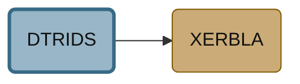

{/* Generated by fumadocs-fortran from examples/modern/src/tridiag.f. Do not edit. */}

External procedure from `examples/modern/src/tridiag.f`.

### DTRIDS [#dtrids]

```f90
subroutine DTRIDS(N, NRHS, DL, D, DU, B, LDB, INFO)
```

<FortranBadges>
<FortranBadge kind="subroutine" />
</FortranBadges>

**DTRIDS** solves a tridiagonal system by the Thomas algorithm

**Purpose**

DTRIDS solves A \* X = B, where A is an N-by-N tridiagonal matrix, by Gaussian elimination without pivoting (the Thomas algorithm). It is written for the fumadocs-fortran example in the style of Reference-LAPACK; use DGTSV from LAPACK for real work.

<small>Author: The fumadocs-fortran example</small>

<FortranArgs columns="type shape intent">
<FortranArg name="N" type="INTEGER" intent="in" decl="INTEGER :: N">

The order of the matrix A. N &gt;= 0.

</FortranArg>
<FortranArg name="NRHS" type="INTEGER" intent="in" decl="INTEGER :: NRHS">

The number of right hand sides, i.e., the number of columns of the matrix B. NRHS &gt;= 0.

</FortranArg>
<FortranArg name="DL" type="DOUBLE PRECISION" dims="(*)" intent="in" decl="DOUBLE PRECISION :: DL(*)">

*DL is DOUBLE PRECISION array, dimension (N-1).*

The (n-1) sub-diagonal elements of A.

</FortranArg>
<FortranArg name="D" type="DOUBLE PRECISION" dims="(*)" intent="inout" decl="DOUBLE PRECISION :: D(*)">

*D is DOUBLE PRECISION array, dimension (N).*

On entry, the diagonal elements of A. On exit, the diagonal elements of the upper triangular factor U.

</FortranArg>
<FortranArg name="DU" type="DOUBLE PRECISION" dims="(*)" intent="in" decl="DOUBLE PRECISION :: DU(*)">

*DU is DOUBLE PRECISION array, dimension (N-1).*

The (n-1) super-diagonal elements of A.

</FortranArg>
<FortranArg name="B" type="DOUBLE PRECISION" dims="(LDB,*)" intent="inout" decl="DOUBLE PRECISION :: B(LDB,*)">

*B is DOUBLE PRECISION array, dimension (LDB,NRHS).*

On entry, the N-by-NRHS right hand side matrix B. On exit, if INFO = 0, the N-by-NRHS solution matrix X.

</FortranArg>
<FortranArg name="LDB" type="INTEGER" intent="in" decl="INTEGER :: LDB">

The leading dimension of the array B. LDB &gt;= max(1,N).

</FortranArg>
<FortranArg name="INFO" type="INTEGER" intent="out" decl="INTEGER :: INFO">

```text
= 0:  successful exit
< 0:  if INFO = -i, the i-th argument had an illegal value
> 0:  if INFO = i, U(i,i) is exactly zero, and the solution
      has not been computed.
```

</FortranArg>
</FortranArgs>

**Calls:** <FortranRef href="https://netlib.org/lapack/explore-html/d0/d50/group__xerbla_ga465456a9b398a91b0801b742989ad793.html#ga465456a9b398a91b0801b742989ad793" title="subroutine xerbla (BLAS)" detail="XERBLA is an error handler for the LAPACK routines.">`XERBLA`</FortranRef>

<FortranGraph title="Call graph" collapsed>



</FortranGraph>

<FortranSource file="examples/modern/src/tridiag.f" line={93} lineEnd={164} href="https://github.com/Nevensky/fumadocs-fortran/blob/main/examples/modern/src/tridiag.f#L93-L164">

```f77 lineNumbers=93
      SUBROUTINE DTRIDS( N, NRHS, DL, D, DU, B, LDB, INFO )
*
*     .. Scalar Arguments ..
      INTEGER            INFO, LDB, N, NRHS
*     ..
*     .. Array Arguments ..
      DOUBLE PRECISION   B( LDB, * ), D( * ), DL( * ), DU( * )
*     ..
*
*  =====================================================================
*
*     .. Parameters ..
      DOUBLE PRECISION   ZERO
      PARAMETER          ( ZERO = 0.0D+0 )
*     ..
*     .. Local Scalars ..
      INTEGER            I, J
      DOUBLE PRECISION   FACT
*     ..
*     .. External Subroutines ..
      EXTERNAL           XERBLA
*     ..
*     .. Intrinsic Functions ..
      INTRINSIC          MAX
*     ..
*     .. Executable Statements ..
*
      INFO = 0
      IF( N.LT.0 ) THEN
         INFO = -1
      ELSE IF( NRHS.LT.0 ) THEN
         INFO = -2
      ELSE IF( LDB.LT.MAX( 1, N ) ) THEN
         INFO = -7
      END IF
      IF( INFO.NE.0 ) THEN
         CALL XERBLA( 'DTRIDS', -INFO )
         RETURN
      END IF
      IF( N.EQ.0 ) RETURN
*
*     Forward elimination
*
      DO 20 I = 1, N - 1
         IF( D( I ).EQ.ZERO ) THEN
            INFO = I
            RETURN
         END IF
         FACT = DL( I ) / D( I )
         D( I+1 ) = D( I+1 ) - FACT*DU( I )
         DO 10 J = 1, NRHS
            B( I+1, J ) = B( I+1, J ) - FACT*B( I, J )
   10    CONTINUE
   20 CONTINUE
      IF( D( N ).EQ.ZERO ) THEN
         INFO = N
         RETURN
      END IF
*
*     Back substitution
*
      DO 40 J = 1, NRHS
         B( N, J ) = B( N, J ) / D( N )
         DO 30 I = N - 1, 1, -1
            B( I, J ) = ( B( I, J )-DU( I )*B( I+1, J ) ) / D( I )
   30    CONTINUE
   40 CONTINUE
      RETURN
*
*     End of DTRIDS
*
      END
```

</FortranSource>
