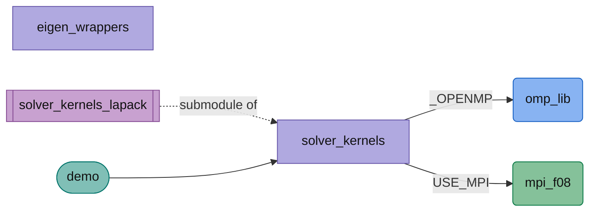

{/* Generated by fumadocs-fortran. Do not edit. */}

## Modules

<Cards>
<Card title="eigen_wrappers" href="/docs/showcase/modern/eigen_wrappers">
{"Eigen-solvers."}
</Card>
<Card title="solver_kernels" href="/docs/showcase/modern/solver_kernels">
{"Dense and banded linear-algebra kernels for a small solver: matrix types, products threaded with OpenMP and offloaded with OpenACC, norms reduced over MPI ranks, and LAPACK-backed solves."}
</Card>
</Cards>

## Submodules

<Cards>
<Card title="solver_kernels_lapack" href="/docs/showcase/modern/solver_kernels_lapack">
{"Submodule with the LAPACK-backed implementations."}
</Card>
</Cards>

## Programs

<Cards>
<Card title="demo" href="/docs/showcase/modern/demo">
{"A driver program."}
</Card>
</Cards>

## Procedures

<Cards>
<Card title="gtsv" href="/docs/showcase/modern/gtsv">
{"1 external procedure: DTRIDS"}
</Card>
</Cards>

## Dependencies

<FortranGraph>

</FortranGraph>
