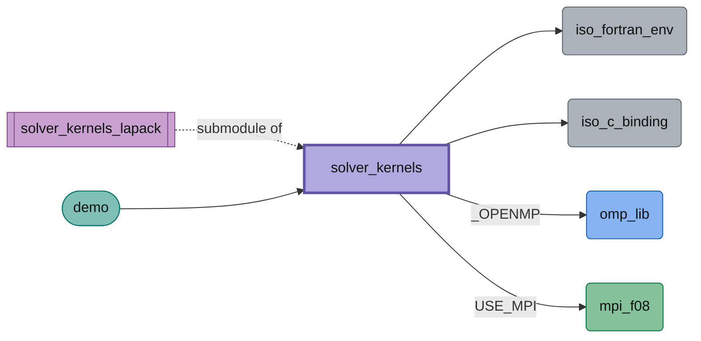
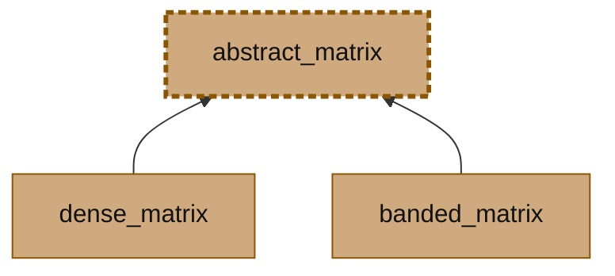
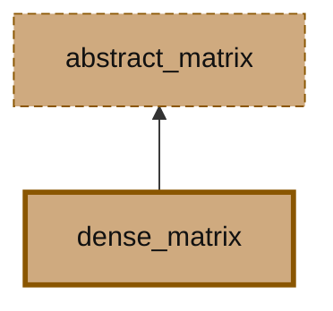
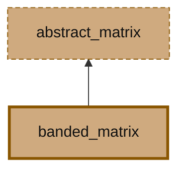
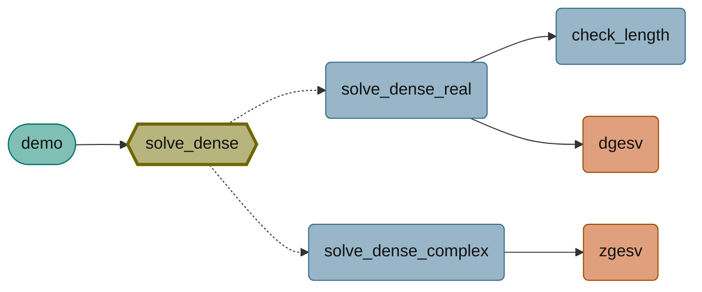
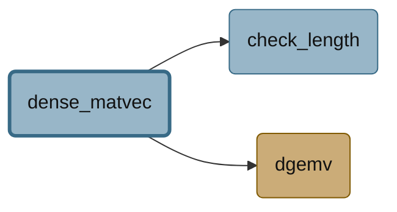
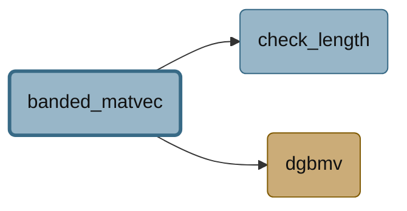
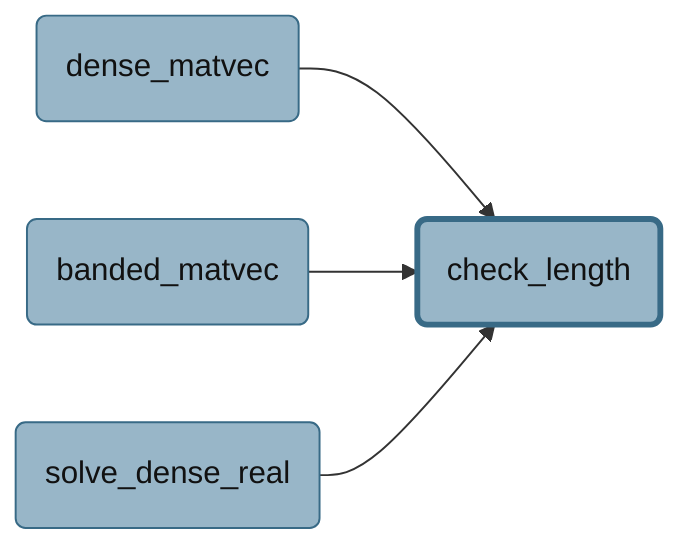
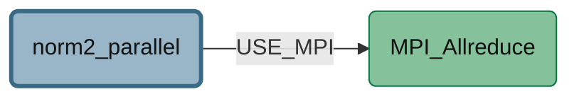

{/* Generated by fumadocs-fortran from examples/modern/src/modern_ford.F90. Do not edit. */}

<FortranBadges>
<FortranBadge kind="module" />
<FortranBadge kind="omp" label="OpenMP" />
<FortranBadge kind="mpi" label="MPI" conditional="USE_MPI" />
<FortranBadge kind="offload" label="OpenMP offload" />
<FortranBadge kind="acc" label="OpenACC" />
<FortranBadge kind="coarray" label="coarrays" />
</FortranBadges>

The kernels solve $A x = b$ for a matrix $A \in \mathbb{R}^{n \times n}$, by LU factorisation with
partial pivoting:

$$
P A = L U, \qquad x = U^{-1} L^{-1} P b.
$$

The residual they report is $r = \|b - A x\|_2 / \|b\|_2$, and the condition number estimate
$$
\begin{equation}
  \kappa_1(A) = \|A\|_1 \, \|A^{-1}\|_1
\end{equation}
$$
comes from LAPACK's `dgecon`.

<Callout type="info" title="Note">

Residuals are reported in the 2-norm, which the maximum norm bounds:
$$
\begin{aligned} \|x\|_2^2 &= \textstyle\sum_i x_i^2 \\ &\le n \max_i x_i^2 \end{aligned}
$$

</Callout>

Start with [`dense_matrix`](/docs/showcase/modern/solver_kernels#dense_matrix) and the generic [`solve_dense`](/docs/showcase/modern/solver_kernels#solve_dense).

**Uses:** `iso_fortran_env` (`dp => real64`, `int64`); `iso_c_binding` (`c_double`, `c_int`); `omp_lib` (`omp_get_max_threads`) when \_OPENMP; `mpi_f08` (`MPI_Comm`, `MPI_Allreduce`, `MPI_IN_PLACE`, `MPI_SUM`, `MPI_DOUBLE_PRECISION`) when USE\_MPI

<FortranSource file="examples/modern/src/modern_ford.F90" line={3} lineEnd={256} href="https://github.com/Nevensky/fumadocs-fortran/blob/main/examples/modern/src/modern_ford.F90#L3-L256" />

<FortranGraph title="Dependencies">



</FortranGraph>

## Types

### color [#color]

```f90
type :: color
```

<FortranBadges>
<FortranBadge kind="type" />
</FortranBadges>

<FortranArgs title="Components" columns="type shape attrs">
<FortranArg name="rgb" type="integer" dims="(3)" attrs="= 0" decl="integer :: rgb(3) = 0">

red, green and blue channels

</FortranArg>
</FortranArgs>

<FortranSource file="examples/modern/src/modern_ford.F90" line={42} lineEnd={44} href="https://github.com/Nevensky/fumadocs-fortran/blob/main/examples/modern/src/modern_ford.F90#L42-L44">

```f90 lineNumbers=42
  type :: color
    integer :: rgb(3) = 0 !! red, green and blue channels
  end type color
```

</FortranSource>

### abstract\_matrix [#abstract_matrix]

```f90
type, abstract :: abstract_matrix
```

<FortranBadges>
<FortranBadge kind="type" />
<FortranBadge kind="abstract" />
</FortranBadges>

An abstract matrix type.

<FortranArgs title="Components" columns="type attrs">
<FortranArg name="n" type="integer" attrs="= 0" decl="integer :: n = 0">

order of the matrix

</FortranArg>
</FortranArgs>

<FortranArgs title="Type-bound procedures" columns="type attrs">
<FortranArg name="matvec" type="procedure(matvec_iface)" attrs="deferred, pass(self)" decl="procedure(matvec_iface), deferred, pass(self) :: matvec">

y = A x

Interface [`matvec_iface`](/docs/showcase/modern/solver_kernels#matvec_iface).

</FortranArg>
<FortranArg name="order" type="=> matrix_order" decl="procedure :: order => matrix_order">

Implemented by [`matrix_order`](/docs/showcase/modern/solver_kernels#matrix_order).

</FortranArg>
<FortranArg name="write(formatted)" type="generic => write_matrix" decl="generic :: write(formatted) => write_matrix">

Implemented by [`write_matrix`](/docs/showcase/modern/solver_kernels#write_matrix).

</FortranArg>
<FortranArg name="write_matrix" type="procedure" attrs="private" decl="procedure, private :: write_matrix">

Implemented by [`write_matrix`](/docs/showcase/modern/solver_kernels#write_matrix).

</FortranArg>
</FortranArgs>

<FortranGraph title="Inheritance" collapsed>



</FortranGraph>

<FortranSource file="examples/modern/src/modern_ford.F90" line={47} lineEnd={54} href="https://github.com/Nevensky/fumadocs-fortran/blob/main/examples/modern/src/modern_ford.F90#L47-L54">

```f90 lineNumbers=47
  type, abstract, public :: abstract_matrix
    integer :: n = 0 !! order of the matrix
  contains
    procedure(matvec_iface), deferred, pass(self) :: matvec !! y = A x
    procedure :: order => matrix_order
    generic :: write(formatted) => write_matrix
    procedure, private :: write_matrix
  end type abstract_matrix
```

</FortranSource>

### dense\_matrix [#dense_matrix]

```f90
type, extends(abstract_matrix) :: dense_matrix
```

<FortranBadges>
<FortranBadge kind="type" />
</FortranBadges>

Dense, column-major matrix.

Extends [`abstract_matrix`](/docs/showcase/modern/solver_kernels#abstract_matrix).

<FortranArgs title="Components" columns="type shape attrs">
<FortranArg name="a" type="real(dp)" dims="(:,:)" attrs="allocatable" decl="real(dp), allocatable :: a(:,:)" refs={{"dp":{"href":"https://gcc.gnu.org/onlinedocs/gfortran/ISO_005fFORTRAN_005fENV.html","title":"dp ⇒ real64","detail":"Real kind with a storage size of 64 bits: double precision","note":"Renamed in the use statement at examples/modern/src/modern_ford.F90:21"}}}>

the entries

</FortranArg>
<FortranArg name="comm" type="type(MPI_Comm)" cond="USE_MPI" decl="type(MPI_Comm) :: comm" refs={{"MPI_Comm":{"href":"https://www.mpi-forum.org/docs/mpi-5.0/mpi50-report/node35.htm","title":"MPI_Comm","detail":"Handle of a communicator: a group of processes and the context their messages are sent in.","note":"From the use of mpi_f08 at examples/modern/src/modern_ford.F90:27"}}}>

communicator the matrix is distributed over

</FortranArg>
</FortranArgs>

<FortranArgs title="Type-bound procedures" columns="type attrs">
<FortranArg name="matvec" type="=> dense_matvec" attrs="pass(self)" decl="procedure, pass(self) :: matvec => dense_matvec">

Implemented by [`dense_matvec`](/docs/showcase/modern/solver_kernels#dense_matvec).

</FortranArg>
</FortranArgs>

<FortranArgs title="Inherited from abstract_matrix" columns="type attrs">
<FortranArg name="n" type="integer" attrs="= 0" decl="integer :: n = 0" />
<FortranArg name="order" type="=> matrix_order" decl="procedure :: order => matrix_order" />
<FortranArg name="write(formatted)" type="generic => write_matrix" decl="generic :: write(formatted) => write_matrix" />
<FortranArg name="write_matrix" type="procedure" attrs="private" decl="procedure, private :: write_matrix" />
</FortranArgs>

**Final:** [`dense_finalize`](/docs/showcase/modern/solver_kernels#dense_finalize)

<FortranGraph title="Inheritance" collapsed>



</FortranGraph>

<FortranSource file="examples/modern/src/modern_ford.F90" line={67} lineEnd={75} href="https://github.com/Nevensky/fumadocs-fortran/blob/main/examples/modern/src/modern_ford.F90#L67-L75">

```f90 lineNumbers=67
  type, extends(abstract_matrix) :: dense_matrix
    real(dp), allocatable :: a(:,:) !! the entries
#ifdef USE_MPI
    type(MPI_Comm) :: comm !! communicator the matrix is distributed over
#endif
  contains
    procedure, pass(self) :: matvec => dense_matvec
    final :: dense_finalize
  end type dense_matrix
```

</FortranSource>

### banded\_matrix [#banded_matrix]

```f90
type, extends(abstract_matrix) :: banded_matrix(k, kl, ku)
```

<FortranBadges>
<FortranBadge kind="type" />
</FortranBadges>

A parameterised derived type: banded storage, where $a_{ij} = 0$ for $j < i - k_l$ or $j > i + k_u$, and
$a_{ij}$ is kept in `ab(ku+1+i-j, j)`.

Extends [`abstract_matrix`](/docs/showcase/modern/solver_kernels#abstract_matrix).

<FortranArgs title="Type parameters" columns="type attrs">
<FortranArg name="k" type="integer, kind" attrs="default dp" decl="integer, kind :: k = dp">

real kind

</FortranArg>
<FortranArg name="kl" type="integer, len" attrs="default 1" decl="integer, len :: kl = 1">

sub-diagonals

</FortranArg>
<FortranArg name="ku" type="integer, len" attrs="default 1" decl="integer, len :: ku = 1">

super-diagonals

</FortranArg>
</FortranArgs>

<FortranArgs title="Components" columns="type shape">
<FortranArg name="ab" type="real(k)" dims="(kl+ku+1,100)" decl="real(k) :: ab(kl+ku+1,100)" refs={{"k":{"title":"integer, kind :: k = dp","detail":"real kind"}}}>

band storage, LAPACK layout

</FortranArg>
</FortranArgs>

<FortranArgs title="Type-bound procedures" columns="type attrs">
<FortranArg name="matvec" type="=> banded_matvec" attrs="pass(self)" decl="procedure, pass(self) :: matvec => banded_matvec">

Implemented by [`banded_matvec`](/docs/showcase/modern/solver_kernels#banded_matvec).

</FortranArg>
</FortranArgs>

<FortranArgs title="Inherited from abstract_matrix" columns="type attrs">
<FortranArg name="n" type="integer" attrs="= 0" decl="integer :: n = 0" />
<FortranArg name="order" type="=> matrix_order" decl="procedure :: order => matrix_order" />
<FortranArg name="write(formatted)" type="generic => write_matrix" decl="generic :: write(formatted) => write_matrix" />
<FortranArg name="write_matrix" type="procedure" attrs="private" decl="procedure, private :: write_matrix" />
</FortranArgs>

<FortranGraph title="Inheritance" collapsed>



</FortranGraph>

<FortranSource file="examples/modern/src/modern_ford.F90" line={79} lineEnd={86} href="https://github.com/Nevensky/fumadocs-fortran/blob/main/examples/modern/src/modern_ford.F90#L79-L86">

```f90 lineNumbers=79
  type, extends(abstract_matrix) :: banded_matrix(k, kl, ku)
    integer, kind :: k = dp      !! real kind
    integer, len  :: kl = 1      !! sub-diagonals
    integer, len  :: ku = 1      !! super-diagonals
    real(k) :: ab(kl+ku+1, 100)  !! band storage, LAPACK layout
  contains
    procedure, pass(self) :: matvec => banded_matvec
  end type banded_matrix
```

</FortranSource>

## Interfaces

### matvec\_iface [#matvec_iface]

```f90
abstract interface
  subroutine matvec_iface(self, x, y)
end interface
```

<FortranBadges>
<FortranBadge kind="subroutine" />
<FortranBadge kind="interface" label="abstract interface" />
<FortranBadge kind="private" />
</FortranBadges>

Matrix-vector product interface: $y \leftarrow A x$.

<FortranArgs columns="type shape intent">
<FortranArg name="self" type="class(abstract_matrix)" intent="in" decl="class(abstract_matrix), intent(in) :: self" refs={{"abstract_matrix":{"href":"/docs/showcase/modern/solver_kernels#abstract_matrix","title":"type, abstract :: abstract_matrix","detail":"An abstract matrix type."}}} />
<FortranArg name="x" type="real(dp)" dims="(:)" intent="in" decl="real(dp), intent(in) :: x(:)" refs={{"dp":{"href":"https://gcc.gnu.org/onlinedocs/gfortran/ISO_005fFORTRAN_005fENV.html","title":"dp ⇒ real64","detail":"Real kind with a storage size of 64 bits: double precision","note":"Renamed in the use statement at examples/modern/src/modern_ford.F90:21"}}}>

input vector

</FortranArg>
<FortranArg name="y" type="real(dp)" dims="(:)" intent="out" decl="real(dp), intent(out) :: y(:)" refs={{"dp":{"href":"https://gcc.gnu.org/onlinedocs/gfortran/ISO_005fFORTRAN_005fENV.html","title":"dp ⇒ real64","detail":"Real kind with a storage size of 64 bits: double precision","note":"Renamed in the use statement at examples/modern/src/modern_ford.F90:21"}}}>

output vector

</FortranArg>
</FortranArgs>

<FortranSource file="examples/modern/src/modern_ford.F90" line={58} lineEnd={63} href="https://github.com/Nevensky/fumadocs-fortran/blob/main/examples/modern/src/modern_ford.F90#L58-L63">

```f90 lineNumbers=58
    subroutine matvec_iface(self, x, y)
      import :: abstract_matrix, dp
      class(abstract_matrix), intent(in) :: self
      real(dp), intent(in)  :: x(:)  !! input vector
      real(dp), intent(out) :: y(:)  !! output vector
    end subroutine matvec_iface
```

</FortranSource>

### operator(+) [#operator-plus]

```f90
interface operator(+)
  module procedure add_dense
end interface
```

<FortranBadges>
<FortranBadge kind="interface" label="operator" />
</FortranBadges>

Add two dense matrices.

**Specific procedures:** [`add_dense`](/docs/showcase/modern/solver_kernels#add_dense)

<FortranGraph title="Call graph" collapsed>


</FortranGraph>

<FortranSource file="examples/modern/src/modern_ford.F90" line={88} lineEnd={91} href="https://github.com/Nevensky/fumadocs-fortran/blob/main/examples/modern/src/modern_ford.F90#L88-L91">

```f90 lineNumbers=88
  interface operator(+)
    !! Add two dense matrices.
    module procedure add_dense
  end interface
```

</FortranSource>

### assignment(=) [#assignment]

```f90
interface assignment(=)
  module procedure assign_from_array
end interface
```

<FortranBadges>
<FortranBadge kind="interface" label="assignment" />
</FortranBadges>

**Specific procedures:** [`assign_from_array`](/docs/showcase/modern/solver_kernels#assign_from_array)

<FortranGraph title="Call graph" collapsed>


</FortranGraph>

<FortranSource file="examples/modern/src/modern_ford.F90" line={93} lineEnd={95} href="https://github.com/Nevensky/fumadocs-fortran/blob/main/examples/modern/src/modern_ford.F90#L93-L95">

```f90 lineNumbers=93
  interface assignment(=)
    module procedure assign_from_array
  end interface
```

</FortranSource>

### solve\_dense [#solve_dense]

```f90
interface solve_dense
  module subroutine solve_dense_real(a, b, info)
  module subroutine solve_dense_complex(a, b, info)
end interface
```

<FortranBadges>
<FortranBadge kind="interface" label="generic interface" />
</FortranBadges>

Generic interface with module procedures implemented in a submodule.

**solve\_dense\_real**: Solve $A X = B$ with LAPACK `dgesv`.

<FortranArgs title="Arguments of subroutine solve_dense_real(a, b, info)" columns="type shape intent attrs">
<FortranArg name="a" type="real(dp)" dims="(:,:)" intent="inout" decl="real(dp), intent(inout) :: a(:,:)" refs={{"dp":{"href":"https://gcc.gnu.org/onlinedocs/gfortran/ISO_005fFORTRAN_005fENV.html","title":"dp ⇒ real64","detail":"Real kind with a storage size of 64 bits: double precision","note":"Renamed in the use statement at examples/modern/src/modern_ford.F90:21"}}}>

on exit, the LU factors

</FortranArg>
<FortranArg name="b" type="real(dp)" dims="(:,:)" intent="inout" decl="real(dp), intent(inout) :: b(:,:)" refs={{"dp":{"href":"https://gcc.gnu.org/onlinedocs/gfortran/ISO_005fFORTRAN_005fENV.html","title":"dp ⇒ real64","detail":"Real kind with a storage size of 64 bits: double precision","note":"Renamed in the use statement at examples/modern/src/modern_ford.F90:21"}}}>

right-hand sides; on exit, the solution

</FortranArg>
<FortranArg name="info" type="integer" intent="out" optional decl="integer, intent(out), optional :: info">

LAPACK info code

</FortranArg>
</FortranArgs>

**solve\_dense\_complex**: Complex version, calls `zgesv`.

<FortranArgs title="Arguments of subroutine solve_dense_complex(a, b, info)" columns="type shape intent attrs">
<FortranArg name="a" type="complex(dp)" dims="(:,:)" intent="inout" decl="complex(dp), intent(inout) :: a(:,:)" refs={{"dp":{"href":"https://gcc.gnu.org/onlinedocs/gfortran/ISO_005fFORTRAN_005fENV.html","title":"dp ⇒ real64","detail":"Real kind with a storage size of 64 bits: double precision","note":"Renamed in the use statement at examples/modern/src/modern_ford.F90:21"}}} />
<FortranArg name="b" type="complex(dp)" dims="(:,:)" intent="inout" decl="complex(dp), intent(inout) :: b(:,:)" refs={{"dp":{"href":"https://gcc.gnu.org/onlinedocs/gfortran/ISO_005fFORTRAN_005fENV.html","title":"dp ⇒ real64","detail":"Real kind with a storage size of 64 bits: double precision","note":"Renamed in the use statement at examples/modern/src/modern_ford.F90:21"}}} />
<FortranArg name="info" type="integer" intent="out" optional decl="integer, intent(out), optional :: info" />
</FortranArgs>

<FortranGraph title="Call graph" collapsed>



</FortranGraph>

<FortranSource file="examples/modern/src/modern_ford.F90" line={98} lineEnd={111} href="https://github.com/Nevensky/fumadocs-fortran/blob/main/examples/modern/src/modern_ford.F90#L98-L111">

```f90 lineNumbers=98
  interface solve_dense
    module subroutine solve_dense_real(a, b, info)
      !! Solve \( A X = B \) with LAPACK `dgesv`.
      real(dp), intent(inout) :: a(:,:)        !! on exit, the LU factors
      real(dp), intent(inout) :: b(:,:)        !! right-hand sides; on exit, the solution
      integer,  intent(out), optional :: info  !! LAPACK info code
    end subroutine solve_dense_real
    module subroutine solve_dense_complex(a, b, info)
      !! Complex version, calls `zgesv`.
      complex(dp), intent(inout) :: a(:,:)
      complex(dp), intent(inout) :: b(:,:)
      integer,     intent(out), optional :: info
    end subroutine solve_dense_complex
  end interface solve_dense
```

</FortranSource>

### matrix\_free [#matrix_free]

```f90
interface
  function matrix_free(n, x) result(r) bind(c, name="matrix_free_c")
end interface
```

<FortranBadges>
<FortranBadge kind="function" />
<FortranBadge kind="interface" label="interface" />
<FortranBadge kind="bindc" label="bind(C)" />
</FortranBadges>

An external C routine.

<FortranArgs columns="type shape intent attrs">
<FortranArg name="n" type="integer(c_int)" intent="in" value decl="integer(c_int), intent(in), value :: n" refs={{"c_int":{"href":"https://gcc.gnu.org/onlinedocs/gfortran/ISO_005fC_005fBINDING.html","title":"c_int","detail":"Integer kind interoperable with C int","note":"From the use statement at examples/modern/src/modern_ford.F90:22"}}} />
<FortranArg name="x" type="real(c_double)" dims="(n)" intent="in" decl="real(c_double), intent(in) :: x(n)" refs={{"c_double":{"href":"https://gcc.gnu.org/onlinedocs/gfortran/ISO_005fC_005fBINDING.html","title":"c_double","detail":"Real kind interoperable with C double","note":"From the use statement at examples/modern/src/modern_ford.F90:22"}}} />
</FortranArgs>

<FortranArgs title="Result" columns="type intent">
<FortranArg name="r" type="real(c_double)" result decl="real(c_double) :: r" refs={{"c_double":{"href":"https://gcc.gnu.org/onlinedocs/gfortran/ISO_005fC_005fBINDING.html","title":"c_double","detail":"Real kind interoperable with C double","note":"From the use statement at examples/modern/src/modern_ford.F90:22"}}} />
</FortranArgs>

<FortranSource file="examples/modern/src/modern_ford.F90" line={115} lineEnd={120} href="https://github.com/Nevensky/fumadocs-fortran/blob/main/examples/modern/src/modern_ford.F90#L115-L120">

```f90 lineNumbers=115
    function matrix_free(n, x) result(r) bind(c, name="matrix_free_c")
      import :: c_int, c_double
      integer(c_int), value, intent(in) :: n
      real(c_double), intent(in) :: x(n)
      real(c_double) :: r
    end function matrix_free
```

</FortranSource>

## Procedures

### matrix\_order [#matrix_order]

```f90
pure integer function matrix_order(self) result(n)
```

<FortranBadges>
<FortranBadge kind="function" />
<FortranBadge kind="pure" />
<FortranBadge kind="private" />
</FortranBadges>

Order of a matrix.

<FortranArgs columns="type intent">
<FortranArg name="self" type="class(abstract_matrix)" intent="in" decl="class(abstract_matrix), intent(in) :: self" refs={{"abstract_matrix":{"href":"/docs/showcase/modern/solver_kernels#abstract_matrix","title":"type, abstract :: abstract_matrix","detail":"An abstract matrix type."}}} />
</FortranArgs>

<FortranArgs title="Result" columns="type intent">
<FortranArg name="n" type="integer" result decl="integer :: n" />
</FortranArgs>

<FortranSource file="examples/modern/src/modern_ford.F90" line={126} lineEnd={129} href="https://github.com/Nevensky/fumadocs-fortran/blob/main/examples/modern/src/modern_ford.F90#L126-L129">

```f90 lineNumbers=126
  pure integer function matrix_order(self) result(n)
    class(abstract_matrix), intent(in) :: self
    n = self%n
  end function matrix_order
```

</FortranSource>

### write\_matrix [#write_matrix]

```f90
subroutine write_matrix(self, unit, iotype, v_list, iostat, iomsg)
```

<FortranBadges>
<FortranBadge kind="subroutine" />
<FortranBadge kind="private" />
</FortranBadges>

<FortranArgs columns="type shape intent">
<FortranArg name="self" type="class(abstract_matrix)" intent="in" decl="class(abstract_matrix), intent(in) :: self" refs={{"abstract_matrix":{"href":"/docs/showcase/modern/solver_kernels#abstract_matrix","title":"type, abstract :: abstract_matrix","detail":"An abstract matrix type."}}} />
<FortranArg name="unit" type="integer" intent="in" decl="integer, intent(in) :: unit" />
<FortranArg name="iotype" type="character(*)" intent="in" decl="character(*), intent(in) :: iotype" />
<FortranArg name="v_list" type="integer" dims="(:)" intent="in" decl="integer, intent(in) :: v_list(:)" />
<FortranArg name="iostat" type="integer" intent="out" decl="integer, intent(out) :: iostat" />
<FortranArg name="iomsg" type="character(*)" intent="inout" decl="character(*), intent(inout) :: iomsg" />
</FortranArgs>

<FortranSource file="examples/modern/src/modern_ford.F90" line={131} lineEnd={139} href="https://github.com/Nevensky/fumadocs-fortran/blob/main/examples/modern/src/modern_ford.F90#L131-L139">

```f90 lineNumbers=131
  subroutine write_matrix(self, unit, iotype, v_list, iostat, iomsg)
    class(abstract_matrix), intent(in) :: self
    integer, intent(in) :: unit
    character(*), intent(in) :: iotype
    integer, intent(in) :: v_list(:)
    integer, intent(out) :: iostat
    character(*), intent(inout) :: iomsg
    write(unit, '(a,i0)', iostat=iostat, iomsg=iomsg) 'matrix of order ', self%n
  end subroutine write_matrix
```

</FortranSource>

### dense\_matvec [#dense_matvec]

```f90
subroutine dense_matvec(self, x, y)
```

<FortranBadges>
<FortranBadge kind="subroutine" />
<FortranBadge kind="private" />
<FortranBadge kind="omp" label="OpenMP parallel region" title="parallel do" />
</FortranBadges>

Dense product $y = A x$, threaded with OpenMP when available, then again with BLAS `dgemv`,
which computes $y \leftarrow \alpha A x + \beta y$ (here $\alpha = 1$, $\beta = 0$).

<FortranArgs columns="type shape intent">
<FortranArg name="self" type="class(dense_matrix)" intent="in" decl="class(dense_matrix), intent(in) :: self" refs={{"dense_matrix":{"href":"/docs/showcase/modern/solver_kernels#dense_matrix","title":"type, extends(abstract_matrix) :: dense_matrix","detail":"Dense, column-major matrix."}}} />
<FortranArg name="x" type="real(dp)" dims="(:)" intent="in" decl="real(dp), intent(in) :: x(:)" refs={{"dp":{"href":"https://gcc.gnu.org/onlinedocs/gfortran/ISO_005fFORTRAN_005fENV.html","title":"dp ⇒ real64","detail":"Real kind with a storage size of 64 bits: double precision","note":"Renamed in the use statement at examples/modern/src/modern_ford.F90:21"}}} />
<FortranArg name="y" type="real(dp)" dims="(:)" intent="out" decl="real(dp), intent(out) :: y(:)" refs={{"dp":{"href":"https://gcc.gnu.org/onlinedocs/gfortran/ISO_005fFORTRAN_005fENV.html","title":"dp ⇒ real64","detail":"Real kind with a storage size of 64 bits: double precision","note":"Renamed in the use statement at examples/modern/src/modern_ford.F90:21"}}} />
</FortranArgs>

**Calls:** [`check_length`](/docs/showcase/modern/solver_kernels#check_length), <FortranRef href="https://www.netlib.org/lapack/explore-html/d7/dda/group__gemv_ga4ac1b675072d18f902db8a310784d802.html#ga4ac1b675072d18f902db8a310784d802" title="subroutine dgemv (BLAS)" detail="Performs one of the matrix-vector operations y := alpha*A*x + beta*y, or y := alpha*A**T*x + beta*y…">`dgemv`</FortranRef>

<FortranGraph title="Call graph" collapsed>



</FortranGraph>

<FortranSource file="examples/modern/src/modern_ford.F90" line={141} lineEnd={155} href="https://github.com/Nevensky/fumadocs-fortran/blob/main/examples/modern/src/modern_ford.F90#L141-L155">

```f90 lineNumbers=141
  subroutine dense_matvec(self, x, y)
    !! Dense product $y = A x$, threaded with OpenMP when available, then again with BLAS `dgemv`,
    !! which computes $y \leftarrow \alpha A x + \beta y$ (here $\alpha = 1$, $\beta = 0$).
    class(dense_matrix), intent(in) :: self
    real(dp), intent(in)  :: x(:)
    real(dp), intent(out) :: y(:)
    integer :: i
    call check_length(self%n, size(x), 'x')
    !$omp parallel do default(shared) private(i) schedule(static)
    do i = 1, self%n
      y(i) = dot_product(self%a(i,:), x)
    end do
    !$omp end parallel do
    call dgemv('N', self%n, self%n, 1.0_dp, self%a, self%n, x, 1, 0.0_dp, y, 1)
  end subroutine dense_matvec
```

</FortranSource>

### banded\_matvec [#banded_matvec]

```f90
subroutine banded_matvec(self, x, y)
```

<FortranBadges>
<FortranBadge kind="subroutine" />
<FortranBadge kind="private" />
</FortranBadges>

<FortranArgs columns="type shape intent">
<FortranArg name="self" type="class(banded_matrix(k=dp, kl=*, ku=*))" intent="in" decl="class(banded_matrix(k=dp, kl=*, ku=*)), intent(in) :: self" refs={{"banded_matrix":{"href":"/docs/showcase/modern/solver_kernels#banded_matrix","title":"type, extends(abstract_matrix) :: banded_matrix(k, kl, ku)","detail":"A parameterised derived type: banded storage, where a_{ij} = 0 for j < i - k_l or j > i + k_u, and a_{ij} is kept in ab(ku+1+i-j, j)."},"dp":{"href":"https://gcc.gnu.org/onlinedocs/gfortran/ISO_005fFORTRAN_005fENV.html","title":"dp ⇒ real64","detail":"Real kind with a storage size of 64 bits: double precision","note":"Renamed in the use statement at examples/modern/src/modern_ford.F90:21"}}} />
<FortranArg name="x" type="real(dp)" dims="(:)" intent="in" decl="real(dp), intent(in) :: x(:)" refs={{"dp":{"href":"https://gcc.gnu.org/onlinedocs/gfortran/ISO_005fFORTRAN_005fENV.html","title":"dp ⇒ real64","detail":"Real kind with a storage size of 64 bits: double precision","note":"Renamed in the use statement at examples/modern/src/modern_ford.F90:21"}}} />
<FortranArg name="y" type="real(dp)" dims="(:)" intent="out" decl="real(dp), intent(out) :: y(:)" refs={{"dp":{"href":"https://gcc.gnu.org/onlinedocs/gfortran/ISO_005fFORTRAN_005fENV.html","title":"dp ⇒ real64","detail":"Real kind with a storage size of 64 bits: double precision","note":"Renamed in the use statement at examples/modern/src/modern_ford.F90:21"}}} />
</FortranArgs>

**Calls:** [`check_length`](/docs/showcase/modern/solver_kernels#check_length), <FortranRef href="https://www.netlib.org/lapack/explore-html/dd/df4/group__gbmv_ga7001c2a185bcc8a3b6731f5d1ea7093e.html#ga7001c2a185bcc8a3b6731f5d1ea7093e" title="subroutine dgbmv (BLAS)" detail="Performs one of the matrix-vector operations y := alpha*A*x + beta*y, or y := alpha*A**T*x + beta*y…">`dgbmv`</FortranRef>

<FortranGraph title="Call graph" collapsed>



</FortranGraph>

<FortranSource file="examples/modern/src/modern_ford.F90" line={157} lineEnd={163} href="https://github.com/Nevensky/fumadocs-fortran/blob/main/examples/modern/src/modern_ford.F90#L157-L163">

```f90 lineNumbers=157
  subroutine banded_matvec(self, x, y)
    class(banded_matrix(k=dp, kl=*, ku=*)), intent(in) :: self
    real(dp), intent(in)  :: x(:)
    real(dp), intent(out) :: y(:)
    call check_length(self%n, size(x), 'x')
    call dgbmv('N', self%n, self%n, self%kl, self%ku, 1.0_dp, self%ab, self%kl+self%ku+1, x, 1, 0.0_dp, y, 1)
  end subroutine banded_matvec
```

</FortranSource>

### check\_length [#check_length]

```f90
subroutine check_length(n, m, what)
```

<FortranBadges>
<FortranBadge kind="subroutine" />
<FortranBadge kind="private" />
</FortranBadges>

Stops with a message when a vector of length `m` does not fit a matrix of order `n`.

<FortranArgs columns="type intent">
<FortranArg name="n" type="integer" intent="in" decl="integer, intent(in) :: n">

the matrix's order

</FortranArg>
<FortranArg name="m" type="integer" intent="in" decl="integer, intent(in) :: m">

the vector's length

</FortranArg>
<FortranArg name="what" type="character(*)" intent="in" decl="character(*), intent(in) :: what">

the vector's name, for the message

</FortranArg>
</FortranArgs>

<FortranGraph title="Call graph" collapsed>



</FortranGraph>

<FortranSource file="examples/modern/src/modern_ford.F90" line={166} lineEnd={171} href="https://github.com/Nevensky/fumadocs-fortran/blob/main/examples/modern/src/modern_ford.F90#L166-L171">

```f90 lineNumbers=166
  subroutine check_length(n, m, what)
    integer, intent(in) :: n !! the matrix's order
    integer, intent(in) :: m !! the vector's length
    character(*), intent(in) :: what !! the vector's name, for the message
    if (m /= n) error stop 'solver_kernels: ' // what // ' does not fit the matrix'
  end subroutine check_length
```

</FortranSource>

### dense\_finalize [#dense_finalize]

```f90
impure elemental subroutine dense_finalize(self)
```

<FortranBadges>
<FortranBadge kind="subroutine" />
<FortranBadge kind="impure" />
<FortranBadge kind="elemental" />
<FortranBadge kind="private" />
</FortranBadges>

<FortranArgs columns="type intent">
<FortranArg name="self" type="type(dense_matrix)" intent="inout" decl="type(dense_matrix), intent(inout) :: self" refs={{"dense_matrix":{"href":"/docs/showcase/modern/solver_kernels#dense_matrix","title":"type, extends(abstract_matrix) :: dense_matrix","detail":"Dense, column-major matrix."}}} />
</FortranArgs>

<FortranSource file="examples/modern/src/modern_ford.F90" line={173} lineEnd={176} href="https://github.com/Nevensky/fumadocs-fortran/blob/main/examples/modern/src/modern_ford.F90#L173-L176">

```f90 lineNumbers=173
  impure elemental subroutine dense_finalize(self)
    type(dense_matrix), intent(inout) :: self
    if (allocated(self%a)) deallocate(self%a)
  end subroutine dense_finalize
```

</FortranSource>

### add\_dense [#add_dense]

```f90
function add_dense(a, b) result(c)
```

<FortranBadges>
<FortranBadge kind="function" />
<FortranBadge kind="private" />
</FortranBadges>

<FortranArgs columns="type intent">
<FortranArg name="a" type="type(dense_matrix)" intent="in" decl="type(dense_matrix), intent(in) :: a" refs={{"dense_matrix":{"href":"/docs/showcase/modern/solver_kernels#dense_matrix","title":"type, extends(abstract_matrix) :: dense_matrix","detail":"Dense, column-major matrix."}}} />
<FortranArg name="b" type="type(dense_matrix)" intent="in" decl="type(dense_matrix), intent(in) :: b" refs={{"dense_matrix":{"href":"/docs/showcase/modern/solver_kernels#dense_matrix","title":"type, extends(abstract_matrix) :: dense_matrix","detail":"Dense, column-major matrix."}}} />
</FortranArgs>

<FortranArgs title="Result" columns="type intent">
<FortranArg name="c" type="type(dense_matrix)" result decl="type(dense_matrix) :: c" refs={{"dense_matrix":{"href":"/docs/showcase/modern/solver_kernels#dense_matrix","title":"type, extends(abstract_matrix) :: dense_matrix","detail":"Dense, column-major matrix."}}} />
</FortranArgs>

<FortranSource file="examples/modern/src/modern_ford.F90" line={178} lineEnd={183} href="https://github.com/Nevensky/fumadocs-fortran/blob/main/examples/modern/src/modern_ford.F90#L178-L183">

```f90 lineNumbers=178
  function add_dense(a, b) result(c)
    type(dense_matrix), intent(in) :: a, b
    type(dense_matrix) :: c
    c%n = a%n
    c%a = a%a + b%a
  end function add_dense
```

</FortranSource>

### assign\_from\_array [#assign_from_array]

```f90
subroutine assign_from_array(lhs, rhs)
```

<FortranBadges>
<FortranBadge kind="subroutine" />
<FortranBadge kind="private" />
</FortranBadges>

<FortranArgs columns="type shape intent">
<FortranArg name="lhs" type="type(dense_matrix)" intent="out" decl="type(dense_matrix), intent(out) :: lhs" refs={{"dense_matrix":{"href":"/docs/showcase/modern/solver_kernels#dense_matrix","title":"type, extends(abstract_matrix) :: dense_matrix","detail":"Dense, column-major matrix."}}} />
<FortranArg name="rhs" type="real(dp)" dims="(:,:)" intent="in" decl="real(dp), intent(in) :: rhs(:,:)" refs={{"dp":{"href":"https://gcc.gnu.org/onlinedocs/gfortran/ISO_005fFORTRAN_005fENV.html","title":"dp ⇒ real64","detail":"Real kind with a storage size of 64 bits: double precision","note":"Renamed in the use statement at examples/modern/src/modern_ford.F90:21"}}} />
</FortranArgs>

<FortranSource file="examples/modern/src/modern_ford.F90" line={185} lineEnd={190} href="https://github.com/Nevensky/fumadocs-fortran/blob/main/examples/modern/src/modern_ford.F90#L185-L190">

```f90 lineNumbers=185
  subroutine assign_from_array(lhs, rhs)
    type(dense_matrix), intent(out) :: lhs
    real(dp), intent(in) :: rhs(:,:)
    lhs%n = size(rhs, 1)
    lhs%a = rhs
  end subroutine assign_from_array
```

</FortranSource>

### norm2\_parallel [#norm2_parallel]

```f90
function norm2_parallel(x, comm) result(nrm)
```

<FortranBadges>
<FortranBadge kind="function" />
<FortranBadge kind="omp" label="OpenMP parallel region" title="parallel do" />
<FortranBadge kind="mpi" label="MPI" conditional="USE_MPI" title="MPI_Allreduce" />
</FortranBadges>

2-norm reduced across OpenMP threads and MPI ranks: each rank $r$ sums the squares of its slice
$I_r$, and an `MPI_Allreduce` adds the partial sums,
$$
\|x\|_2 = \Big( \sum_{r=0}^{p-1} \sum_{i \in I_r} x_i^2 \Big)^{1/2}.
$$

<FortranArgs columns="type shape intent attrs">
<FortranArg name="x" type="real(dp)" dims="(:)" intent="in" decl="real(dp), intent(in) :: x(:)" refs={{"dp":{"href":"https://gcc.gnu.org/onlinedocs/gfortran/ISO_005fFORTRAN_005fENV.html","title":"dp ⇒ real64","detail":"Real kind with a storage size of 64 bits: double precision","note":"Renamed in the use statement at examples/modern/src/modern_ford.F90:21"}}}>

local slice of the vector

</FortranArg>
<FortranArg name="comm" type="type(MPI_Comm)" intent="in" cond="USE_MPI" decl="type(MPI_Comm), intent(in) :: comm" refs={{"MPI_Comm":{"href":"https://www.mpi-forum.org/docs/mpi-5.0/mpi50-report/node35.htm","title":"MPI_Comm","detail":"Handle of a communicator: a group of processes and the context their messages are sent in.","note":"From the use of mpi_f08 at examples/modern/src/modern_ford.F90:27"}}}>

communicator

</FortranArg>
</FortranArgs>

<FortranArgs title="Result" columns="type intent">
<FortranArg name="nrm" type="real(dp)" result decl="real(dp) :: nrm" refs={{"dp":{"href":"https://gcc.gnu.org/onlinedocs/gfortran/ISO_005fFORTRAN_005fENV.html","title":"dp ⇒ real64","detail":"Real kind with a storage size of 64 bits: double precision","note":"Renamed in the use statement at examples/modern/src/modern_ford.F90:21"}}}>

the global 2-norm

</FortranArg>
</FortranArgs>

**Calls:** <FortranRef href="https://docs.open-mpi.org/en/v5.0.x/man-openmpi/man3/MPI_Allreduce.3.html" title="subroutine MPI_Allreduce (MPI)" detail="Combines values from all processes and distributes the result back to all processes.">`MPI_Allreduce`</FortranRef> when USE\_MPI

<FortranGraph title="Call graph" collapsed>



</FortranGraph>

<FortranSource file="examples/modern/src/modern_ford.F90" line={195} lineEnd={217} href="https://github.com/Nevensky/fumadocs-fortran/blob/main/examples/modern/src/modern_ford.F90#L195-L217">

```f90 lineNumbers=195
  function norm2_parallel(x &
#ifdef USE_MPI
      , comm &
#endif
      ) result(nrm)
    real(dp), intent(in) :: x(:) !! local slice of the vector
#ifdef USE_MPI
    type(MPI_Comm), intent(in) :: comm !! communicator
#endif
    real(dp) :: nrm !! the global 2-norm
    real(dp) :: s
    integer :: i
    s = 0.0_dp
    !$omp parallel do reduction(+:s)
    do i = 1, size(x)
      s = s + x(i)**2
    end do
    !$omp end parallel do
#ifdef USE_MPI
    call MPI_Allreduce(MPI_IN_PLACE, s, 1, MPI_DOUBLE_PRECISION, MPI_SUM, comm)
#endif
    nrm = sqrt(s)
  end function norm2_parallel
```

</FortranSource>

### axpy\_elem [#axpy_elem]

```f90
pure real(dp) function axpy_elem(a, x, y)
```

<FortranBadges>
<FortranBadge kind="function" />
<FortranBadge kind="pure" />
<FortranBadge kind="private" />
<FortranBadge kind="offload" label="OpenMP offload" title="declare target" />
<FortranBadge kind="acc" label="OpenACC routine" />
</FortranBadges>

A device routine for OpenACC and OpenMP offload: one element of $a x + y$.

<FortranArgs columns="type attrs">
<FortranArg name="a" type="real(dp)" value decl="real(dp), value :: a" refs={{"dp":{"href":"https://gcc.gnu.org/onlinedocs/gfortran/ISO_005fFORTRAN_005fENV.html","title":"dp ⇒ real64","detail":"Real kind with a storage size of 64 bits: double precision","note":"Renamed in the use statement at examples/modern/src/modern_ford.F90:21"}}} />
<FortranArg name="x" type="real(dp)" value decl="real(dp), value :: x" refs={{"dp":{"href":"https://gcc.gnu.org/onlinedocs/gfortran/ISO_005fFORTRAN_005fENV.html","title":"dp ⇒ real64","detail":"Real kind with a storage size of 64 bits: double precision","note":"Renamed in the use statement at examples/modern/src/modern_ford.F90:21"}}} />
<FortranArg name="y" type="real(dp)" value decl="real(dp), value :: y" refs={{"dp":{"href":"https://gcc.gnu.org/onlinedocs/gfortran/ISO_005fFORTRAN_005fENV.html","title":"dp ⇒ real64","detail":"Real kind with a storage size of 64 bits: double precision","note":"Renamed in the use statement at examples/modern/src/modern_ford.F90:21"}}} />
</FortranArgs>

<FortranArgs title="Result" columns="type intent">
<FortranArg name="axpy_elem" type="real(dp)" result decl="real(dp) :: axpy_elem" refs={{"dp":{"href":"https://gcc.gnu.org/onlinedocs/gfortran/ISO_005fFORTRAN_005fENV.html","title":"dp ⇒ real64","detail":"Real kind with a storage size of 64 bits: double precision","note":"Renamed in the use statement at examples/modern/src/modern_ford.F90:21"}}} />
</FortranArgs>

<FortranSource file="examples/modern/src/modern_ford.F90" line={220} lineEnd={225} href="https://github.com/Nevensky/fumadocs-fortran/blob/main/examples/modern/src/modern_ford.F90#L220-L225">

```f90 lineNumbers=220
  pure real(dp) function axpy_elem(a, x, y)
    !$acc routine seq
    !$omp declare target
    real(dp), value :: a, x, y
    axpy_elem = a*x + y
  end function axpy_elem
```

</FortranSource>

### rank\_sum [#rank_sum]

```f90
subroutine rank_sum(x, total)
```

<FortranBadges>
<FortranBadge kind="subroutine" />
<FortranBadge kind="private" />
<FortranBadge kind="coarray" label="coarrays" />
</FortranBadges>

Rank-generic sum $s = \sum_{i} x_i$ with `select rank`, reduced over all images with `co_sum`.

<FortranArgs columns="type shape intent">
<FortranArg name="x" type="real(dp)" dims="(..)" intent="in" decl="real(dp), intent(in) :: x(..)" refs={{"dp":{"href":"https://gcc.gnu.org/onlinedocs/gfortran/ISO_005fFORTRAN_005fENV.html","title":"dp ⇒ real64","detail":"Real kind with a storage size of 64 bits: double precision","note":"Renamed in the use statement at examples/modern/src/modern_ford.F90:21"}}} />
<FortranArg name="total" type="real(dp)" codims="[*]" intent="out" decl="real(dp), intent(out) :: total[*]" refs={{"dp":{"href":"https://gcc.gnu.org/onlinedocs/gfortran/ISO_005fFORTRAN_005fENV.html","title":"dp ⇒ real64","detail":"Real kind with a storage size of 64 bits: double precision","note":"Renamed in the use statement at examples/modern/src/modern_ford.F90:21"}}} />
</FortranArgs>

**Calls:** <FortranRef href="https://fortran-lang.org/learn/intrinsics/parallel/#co-sum" title="subroutine co_sum (intrinsic)" detail="Sum of values on the current set of images">`co_sum`</FortranRef>

<FortranGraph title="Call graph" collapsed>


</FortranGraph>

<FortranSource file="examples/modern/src/modern_ford.F90" line={228} lineEnd={240} href="https://github.com/Nevensky/fumadocs-fortran/blob/main/examples/modern/src/modern_ford.F90#L228-L240">

```f90 lineNumbers=228
  subroutine rank_sum(x, total)
    real(dp), intent(in) :: x(..)
    real(dp), intent(out) :: total[*]
    select rank (x)
    rank (1)
      total = sum(x)
    rank (2)
      total = sum(x)
    rank default
      total = 0.0_dp
    end select
    call co_sum(total)
  end subroutine rank_sum
```

</FortranSource>

### concurrent\_scale [#concurrent_scale]

```f90
subroutine concurrent_scale(x, alpha)
```

<FortranBadges>
<FortranBadge kind="subroutine" />
<FortranBadge kind="private" />
</FortranBadges>

Scales a vector in place,
$$
x_i \leftarrow \alpha \, x_i, \qquad i = 1, \dots, n,
$$
in a `do concurrent` loop, where `local_init` gives each iteration its own copy of the factor.

<FortranArgs columns="type shape intent">
<FortranArg name="x" type="real(dp)" dims="(:)" intent="inout" decl="real(dp), intent(inout) :: x(:)" refs={{"dp":{"href":"https://gcc.gnu.org/onlinedocs/gfortran/ISO_005fFORTRAN_005fENV.html","title":"dp ⇒ real64","detail":"Real kind with a storage size of 64 bits: double precision","note":"Renamed in the use statement at examples/modern/src/modern_ford.F90:21"}}} />
<FortranArg name="alpha" type="real(dp)" intent="in" decl="real(dp), intent(in) :: alpha" refs={{"dp":{"href":"https://gcc.gnu.org/onlinedocs/gfortran/ISO_005fFORTRAN_005fENV.html","title":"dp ⇒ real64","detail":"Real kind with a storage size of 64 bits: double precision","note":"Renamed in the use statement at examples/modern/src/modern_ford.F90:21"}}} />
</FortranArgs>

<FortranSource file="examples/modern/src/modern_ford.F90" line={245} lineEnd={254} href="https://github.com/Nevensky/fumadocs-fortran/blob/main/examples/modern/src/modern_ford.F90#L245-L254">

```f90 lineNumbers=245
  subroutine concurrent_scale(x, alpha)
    real(dp), intent(inout) :: x(:)
    real(dp), intent(in) :: alpha
    integer :: i
    real(dp) :: s
    s = alpha
    do concurrent (i = 1:size(x)) local_init(s)
      x(i) = s*x(i)
    end do
  end subroutine concurrent_scale
```

</FortranSource>

## Variables

### max\_order [#max_order]

```f90
integer, parameter :: max_order = 64
```

<FortranBadges>
<FortranBadge kind="parameter" label="parameter" />
</FortranBadges>

largest supported order

<FortranSource file="examples/modern/src/modern_ford.F90" line={36} href="https://github.com/Nevensky/fumadocs-fortran/blob/main/examples/modern/src/modern_ford.F90#L36">

```f90 lineNumbers=36
  integer, parameter, public :: max_order = 64 !! largest supported order
```

</FortranSource>

## Enumerations

### RED, GREEN [#enum-1]

```f90
enum, bind(c)
  enumerator :: RED = 1, GREEN
end enum
```

<FortranArgs title="Enumerators" columns="attrs">
<FortranArg name="RED" attrs="= 1" decl="enumerator :: RED = 1" />
<FortranArg name="GREEN" decl="enumerator :: GREEN" />
</FortranArgs>

<FortranSource file="examples/modern/src/modern_ford.F90" line={38} lineEnd={40} href="https://github.com/Nevensky/fumadocs-fortran/blob/main/examples/modern/src/modern_ford.F90#L38-L40">

```f90 lineNumbers=38
  enum, bind(c)
    enumerator :: RED = 1, GREEN
  end enum
```

</FortranSource>
