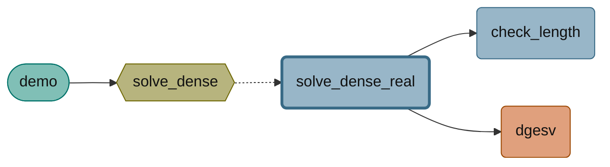
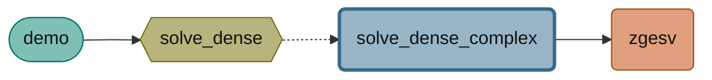

{/* Generated by fumadocs-fortran from examples/modern/src/modern_ford.F90. Do not edit. */}

<FortranBadges>
<FortranBadge kind="submodule" />
</FortranBadges>

Submodule of [`solver_kernels`](/docs/showcase/modern/solver_kernels).

<FortranSource file="examples/modern/src/modern_ford.F90" line={259} lineEnd={277} href="https://github.com/Nevensky/fumadocs-fortran/blob/main/examples/modern/src/modern_ford.F90#L259-L277" />

<FortranGraph title="Dependencies">


</FortranGraph>

## Procedures

### solve_dense_real [#solve_dense_real]

```f90
module subroutine solve_dense_real(a, b, info)
```

<FortranBadges>
<FortranBadge kind="subroutine" />
<FortranBadge kind="submodule" label="separate module procedure" />
<FortranBadge kind="private" />
</FortranBadges>

Solve $A X = B$ with LAPACK `dgesv`.

Implements `solve_dense_real`, declared in the interface [`solve_dense`](/docs/showcase/modern/solver_kernels#solve_dense) of [`solver_kernels`](/docs/showcase/modern/solver_kernels).

<FortranArgs columns="type shape intent attrs">
<FortranArg name="a" type="real(dp)" dims="(:,:)" intent="inout" decl="real(dp), intent(inout) :: a(:,:)" refs={{"dp":{"href":"https://gcc.gnu.org/onlinedocs/gfortran/ISO_005fFORTRAN_005fENV.html","title":"dp ⇒ real64","detail":"Real kind with a storage size of 64 bits: double precision","note":"Renamed in the use statement at examples/modern/src/modern_ford.F90:21"}}}>

on exit, the LU factors

</FortranArg>
<FortranArg name="b" type="real(dp)" dims="(:,:)" intent="inout" decl="real(dp), intent(inout) :: b(:,:)" refs={{"dp":{"href":"https://gcc.gnu.org/onlinedocs/gfortran/ISO_005fFORTRAN_005fENV.html","title":"dp ⇒ real64","detail":"Real kind with a storage size of 64 bits: double precision","note":"Renamed in the use statement at examples/modern/src/modern_ford.F90:21"}}}>

right-hand sides; on exit, the solution

</FortranArg>
<FortranArg name="info" type="integer" intent="out" optional decl="integer, intent(out), optional :: info">

LAPACK info code

</FortranArg>
</FortranArgs>

**Calls:** [`check_length`](/docs/showcase/modern/solver_kernels#check_length), <FortranRef href="https://netlib.org/lapack/explore-html/d8/da6/group__gesv_ga831ce6a40e7fd16295752d18aed2d541.html#ga831ce6a40e7fd16295752d18aed2d541" title="subroutine dgesv (LAPACK)" detail="Computes the solution to system of linear equations A * X = B for GE matrices">`dgesv`</FortranRef>

<FortranGraph title="Call graph" collapsed>



</FortranGraph>

<FortranSource file="examples/modern/src/modern_ford.F90" line={262} lineEnd={270} href="https://github.com/Nevensky/fumadocs-fortran/blob/main/examples/modern/src/modern_ford.F90#L262-L270">

```f90 lineNumbers=262
  module subroutine solve_dense_real(a, b, info)
    real(dp), intent(inout) :: a(:,:)
    real(dp), intent(inout) :: b(:,:)
    integer,  intent(out), optional :: info
    integer :: ipiv(size(a,1)), stat
    call check_length(size(a,1), size(b,1), 'b')
    call dgesv(size(a,1), size(b,2), a, size(a,1), ipiv, b, size(b,1), stat)
    if (present(info)) info = stat
  end subroutine solve_dense_real
```

</FortranSource>

### solve_dense_complex [#solve_dense_complex]

```f90
module procedure solve_dense_complex
```

<FortranBadges>
<FortranBadge kind="subroutine" />
<FortranBadge kind="submodule" label="separate module procedure" />
<FortranBadge kind="private" />
</FortranBadges>

Complex version, calls `zgesv`.

Implements `solve_dense_complex`, declared in the interface [`solve_dense`](/docs/showcase/modern/solver_kernels#solve_dense) of [`solver_kernels`](/docs/showcase/modern/solver_kernels).

<FortranArgs columns="type shape intent attrs">
<FortranArg name="a" type="complex(dp)" dims="(:,:)" intent="inout" decl="complex(dp), intent(inout) :: a(:,:)" refs={{"dp":{"href":"https://gcc.gnu.org/onlinedocs/gfortran/ISO_005fFORTRAN_005fENV.html","title":"dp ⇒ real64","detail":"Real kind with a storage size of 64 bits: double precision","note":"Renamed in the use statement at examples/modern/src/modern_ford.F90:21"}}} />
<FortranArg name="b" type="complex(dp)" dims="(:,:)" intent="inout" decl="complex(dp), intent(inout) :: b(:,:)" refs={{"dp":{"href":"https://gcc.gnu.org/onlinedocs/gfortran/ISO_005fFORTRAN_005fENV.html","title":"dp ⇒ real64","detail":"Real kind with a storage size of 64 bits: double precision","note":"Renamed in the use statement at examples/modern/src/modern_ford.F90:21"}}} />
<FortranArg name="info" type="integer" intent="out" optional decl="integer, intent(out), optional :: info" />
</FortranArgs>

**Calls:** <FortranRef href="https://netlib.org/lapack/explore-html/d8/da6/group__gesv_ga0850dc117a6c7ec3cb64905d5de1cd23.html#ga0850dc117a6c7ec3cb64905d5de1cd23" title="subroutine zgesv (LAPACK)" detail="Computes the solution to system of linear equations A * X = B for GE matrices (simple driver)">`zgesv`</FortranRef>

<FortranGraph title="Call graph" collapsed>



</FortranGraph>

<FortranSource file="examples/modern/src/modern_ford.F90" line={272} lineEnd={276} href="https://github.com/Nevensky/fumadocs-fortran/blob/main/examples/modern/src/modern_ford.F90#L272-L276">

```f90 lineNumbers=272
  module procedure solve_dense_complex
    integer :: ipiv(size(a,1)), stat
    call zgesv(size(a,1), size(b,2), a, size(a,1), ipiv, b, size(b,1), stat)
    if (present(info)) info = stat
  end procedure solve_dense_complex
```

</FortranSource>
